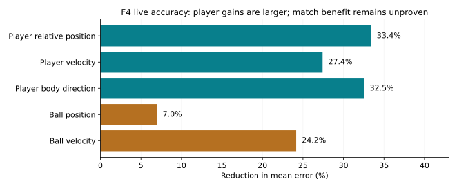

# Exp3–Exp4 · What we achieved and what to keep

2026-11-15 · Research archive and handoff

## Summary

**We reduced estimation error, especially player position. We did not
establish a reliable match-performance advantage.** Retain the Step26
player-position model as the strongest accuracy result. Keep player
velocity/body as separately testable candidates. Archive ball correction
as experimental because its average gain did not resolve kick-time motion
errors or temporal instability.

This directory summarizes the completed work. The original Exp3/Exp4
scripts, individual steps and evidence remain at their original locations.

## What we did

1. Collected 200 baseline games with quantized 360° observations, persistent
   uniform numbers, no teammate payloads and reference-only fullstate.
2. Tested geometry/reachability filters, temporal GRUs, nearby-player/ball
   context, uniform-number embeddings, masked neighbor pooling, range/bearing
   readouts and single/multiple movement hypotheses.
3. Selected Step26 for live player-position correction: eight-cycle
   recurrent history, masked nearby-player context and a bounded range/bearing
   correction consistent with the quantized observation.
4. Trained Exp4 models for player velocity/body, current ball position/velocity
   and one-cycle ball state. Tested estimated kicker identity and controlled
   versus free-ball forecast heads.
5. Integrated models, audited live logs, repaired observation-history feedback
   and ball-path inconsistencies, and added close-range guards.
6. Added opt-in synchronous random command priority to remove the identified
   receive-speed advantage. Built before/after visualization and inspected
   observer 9's ball failures.

Exp1 → Exp3's broad player-track mean changed **159.5 → 80.0 cm**, mainly
under a combined change in coverage and age distribution. That is not a
neural-model gain. Fresh raw error at 10–20 m stayed essentially unchanged:
39.60 versus 39.54 cm. The model comparisons below pair the same samples.

[Configuration and baseline diagnostics](../exp3/README.md) ·
[All research steps](../exp3/reports/step-summary.md)

## How much error we removed

### Offline held-out results

Each row compares the stated method with its own matched baseline. The
rows have different target/cohort definitions; their improvements cannot
be added together.

| Quantity | Stock → selected model | Reduction | Solution |
|---|---:|---:|---|
| Player relative position | 72.79 → 48.16 cm | 33.8% | Exp3 Step26: bounded range and bearing, recurrent masked context |
| Player velocity | 9.59 → 7.24 cm/cycle | 24.5% | Exp4 context GRU with gated body policy |
| Player body direction | 21.97 → 14.74 degrees | 32.9% | Exp4 context GRU with validation-selected body gate |
| Ball current position | 68.75 → 63.98 cm | 6.9% | Quantization-constrained current-state model |
| Ball current velocity | 27.63 → 21.66 cm/cycle | 21.6% | Same quantization-constrained current-state model |
| Ball next position | 87.02 → 80.81 cm | 7.1% | Controlled/free-ball forecast heads; not final live policy |
| Ball next velocity | 40.59 → 33.97 cm/cycle | 16.3% | Controlled/free-ball forecast heads; log-only in F4 |

Step26's player-position mean improved in 19 of 20 held-out 360° games.
The preceding masked-context range-only model reached **48.48 cm**;
the bounded-bearing addition reached **48.16 cm**, with a small p90
regression. Extra forecast heads and the mixture model did not beat Step26
for fresh position correction.

For velocity alone, the history-only player GRU scored 7.18 cm/cycle,
slightly below the selected context policy's 7.24. The lowest individual
ball-velocity result was 21.50 cm/cycle from the controlled/free-head
candidate; the selected quantization-constrained current-state model
scored 21.66. These are alternative policies, not additional additive gains.

For player body, preserving observed angles mattered: raw observed body
was already about 0.33° error, while ungated model replacement raised it
to 3.25°. Estimated kicker identity helped the ball model numerically,
but that cue is not a known action or true possession label.

[Step26](../exp3/reports/26-bounded-bearing.md) ·
[Forecast comparison](../exp3/reports/28-mixture-forecast.md) ·
[Exp4 offline state models](../exp4/reports/01-state-models.md)

### Live paired accuracy after the F4 integration repair

The following is one consistent cohort: the original F4 first 60 games,
all treatment observers, PlayOn only. Each eligible observer–target–cycle
has equal weight. Stock and applied estimates are scored against the same
truth on the same row. These games predate the scheduling control; that
confounds game outcomes, not the definition of these paired errors.

| Quantity | Stock → applied | Reduction |
|---|---:|---:|
| Player relative position | 78.42 → 52.22 cm | 33.4% |
| Player velocity | 10.43 → 7.57 cm/cycle | 27.4% |
| Player body direction | 25.17 → 16.98 degrees | 32.5% |
| Ball position | 75.17 → 69.92 cm | 7.0% |
| Ball velocity | 32.49 → 24.64 cm/cycle | 24.2% |

These are mean gains, not an improvement on every frame. In that cohort,
ball position worsened on 42.3% of rows, ball velocity on 37.5%, player
position on 32.7% and player velocity on 35.6%. F4 preserves stock ball
state below 5 m observer range, player velocity below 10 m, and directly
observed body direction. Learned ball forecasts remain log-only.

The later randomized-priority first-15 sample was consistent: player
relative position **78.91 → 52.96 cm** and ball velocity
**32.41 → 24.83 cm/cycle**. That was a three-observer-per-game health sample,
not a complete final-batch accuracy audit.

[Full 60-game accuracy audit](../exp4/reports/05-live-f4-60-games.md) ·
[Random-priority first 15](../exp4/reports/07-random-order-first15.md)

## What happened in actual games

Every treatment in this table played on the left. Separate batches have
different trajectories and configurations, so scores are not a controlled
ball-on/ball-off comparison.

| Batch | Treatment | Games | Goals, left–right | Left W–D–L | Mean goal margin |
|---|---|---:|---:|---:|---:|
| Exp3 baseline | Stock versus stock | 200 | 795–796 | 81–38–81 | −0.005 |
| F1 | Player position, legacy routing | 200 | 816–807 | 85–34–81 | +0.045 |
| F2 | Player position, corrected routing | 100 | 386–359 | 43–17–40 | +0.270 |
| F3 | Combined player/ball state, initial integration | 155 | 671–671 | 59–22–74 | 0.000 |
| F4 original snapshot | Combined state after integration repair | 60 | 222–225 | 24–11–25 | −0.050 |
| Random-priority snapshot | Combined state with new scheduling | 35 | 122–143 | 10–8–17 | −0.600 |

F2 is the most favorable recorded player-position-only score margin here,
but its 95% game-bootstrap interval is **−0.24 to +0.80 goals/game**.
F1's interval is **−0.33 to +0.43**. Neither establishes a reliable benefit.

The randomized snapshot's interval is **−1.46 to +0.29**. It contained
35 finalized games at closeout, not the planned 200 completed games.
Do not describe it as a completed 200-game result.

One concrete live problem was fixed: before random scheduling, newly
charged simultaneous kicks were blocked 96.0% on the treatment side and
11.6% on the stock side. In the verified first-15 randomized snapshot,
the corresponding rates were 49.3% and 50.0%. This verifies the scheduling
control; it does not itself prove a model-related win-rate improvement.

[Player-position game results](../exp3/reports/31-live-results.md) ·
[Combined-state closeout and exact game selection](../exp4/reports/09-closeout-ball-stability.md)

## Why we are not keeping ball correction as the default

Observer left 9's replay confirmed two failure modes:

- At cycles 784–787, the ball was seen but motion fields were omitted at
  reported ranges 40.4–44.7 m. Stock velocity was invalid; the model
  supplied an almost horizontal velocity after player 10's kicks, while
  the real ball moved diagonally. Fresh motion at 788 restored the direction.
- At cycles 789–802, range-bin transitions already caused stock position
  jumps. The model reduced the mean position error **0.879 → 0.706 m**,
  but worsened four of 14 individual positions and did not eliminate jitter.
  At 790, coasting the previous applied state would have 0.41 m error,
  versus 1.65 m after the fresh correction. Other cycles favored the fresh
  update, so this is not an always-coast rule.

The experiment therefore does not show that ball modeling is impossible,
or that all instability was introduced by the model. It shows that this
model and integration are not sufficiently reliable in the important
situations we inspected.

[Plots, screenshots and per-cycle evidence](../exp4/reports/09-closeout-ball-stability.html)

## What is archived and reusable

| Repository | Preserved source | What it contains |
|---|---|---|
| librcsc-denoise | denoise-exp3-exp4, b0894ef | Model hooks/history, guarded state application, schema-3 records, snapshots, debug helpers and server-parameter mirrors |
| helios-base-denoise | denoise-exp3-exp4, ba8fe96 | Weight loading/inference, model flags, corrected decision routing and debug overlays |
| rcssserver-denoise | denoise | Experiment controls, reports/scripts and optional random command batching |

The lib/base archive commits match their local origin-tracking refs.
Both source working trees are on denoise. No branch switch, commit or push
is required to create this summary. Server changes remain uncommitted for
the user's commit.

For later experiments, retrieve only instrumentation that is needed.
Do not inadvertently enable the old models by importing an entire live
integration stack. Existing build/bin and build-debug/bin executables do
not change when the source branch is switched; rebuild before new data
collection.

Known archived visualization limitation: requested circle colors are
dropped by CirclePrinter's inverted empty-string condition. Coordinates
and numeric annotations were checked, but some outlines appear orange.
This is documented and remains unchanged.

## Handoff: isolate prediction during visual gaps

The next question is: **given accurate information when a player is
visible, how well can we estimate its position while it is outside the
current view?**

Start with separate 60°/120°/180° view conditions and then standard
adaptive view control. Keep visual identity, motion-field availability,
hearing and observation cadence explicit. With a finite view cone,
visibility and update frequency are separate causes of gaps. Record
actual view width and observation ages every cycle.

Before collecting data:

1. Define and verify what “no observation noise” includes. Current
   server::see_noise_free removes distance quantization; bearing and motion
   rounding remain. Self-localization error can also affect global positions.
   Do not label that existing flag alone a fully noiseless observation model.
2. Retain reference fullstate strictly for labels and evaluation. If exact
   visible-only measurements are used in a controlled experiment, specify
   that visibility mask and ensure unseen truth cannot enter model inputs.
3. Preserve position/velocity ages, actual observations, view settings and
   action/context history in the logs. Test the logger before choosing
   which archived instrumentation to bring back.
4. Compare stock librcsc with simple motion baselines before training.
   Score all eligible unseen-player cycles by gap age, distance, velocity
   availability and context, with whole-game splits and equal sample weights.

The 360° Step26 model required eight consecutive sightings; its normal-view
replay covered only **0.93%** of fresh identified observations. It is not
already a solution for this next question. Exp3's gap-aware filters,
motion-path and likelihood reports contain reusable negative findings;
read those before repeating work.

[Normal-view coverage](../exp3/reports/08-normal-view.md) ·
[Earlier gap-aware study](../exp3/reports/09-gap-aware-history.md) ·
[Motion-path limitations](../exp3/reports/18-motion-paths.md)

This archive step does not start the next dataset, alter sensing behavior,
or train a new model.
