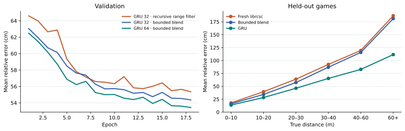

# Exp3 Step 02 — Temporal player range

On **3,902,451 paired observations from 20 held-out games**, the selected
GRU reduced mean relative-position error from **72.79 to 50.61 cm**
versus fresh librcsc (**30.5%**). Mean global-position error went from
**74.51 to 52.83 cm**. These measurements come from an
offline replay of the 360° Exp3 configuration.

## Data and methods

- The sequence dataset uses one seeded observer number per game on each side
  and all 21 targets per observer. The split has 160 train, 20 validation and
  20 test games. The five smoke-test games belong to the training split.
- Eight consecutive PlayOn observations form a window. Windows never cross a
  missing observation or cycle gap. Test scores include every eligible window
  endpoint after warmup and weight all samples equally.
- Inputs include quantized range and bearing, estimated observer motion,
  available target motion fields and their mask, quantization interval width,
  and the filter prior. Fullstate supplies training labels and scoring truth.
- Constant velocity extrapolates the previous visual position with smoothed
  velocity. The fixed blend uses 65% current visual position and 35% predicted
  position. The recursive range filter follows its previous filtered state
  within the server's range interval. The bounded blend projects the fixed
  blend into the current range and bearing bounds.
- The GRU learns a radial correction within the current range interval. The
  bounded-blend variant retains the bounded blend's angle. Both use AdamW,
  61,440 sampled windows per epoch, the same seed, and up to 18 epochs.

## Model selection on validation

| Candidate | Selected epoch | Relative mean |
|---|---:|---:|
| GRU 32 · recursive range filter | 18 | 55.35 cm |
| GRU 32 · bounded blend | 18 | 54.36 cm |
| GRU 64 · bounded blend | 18 | 53.43 cm |

All candidates use the same validation endpoints. The checkpoint was chosen
by relative mean before using the final test scores.

## Held-out comparison

| Method | Relative mean | Relative p90 | Global mean | Global p90 |
|---|---:|---:|---:|---:|
| Raw polar decode | 72.71 cm | 154.08 cm | 74.44 cm | 155.79 cm |
| Fresh librcsc | 72.79 cm | 154.50 cm | 74.51 cm | 156.24 cm |
| Constant velocity | 88.59 cm | 184.88 cm | 89.48 cm | 186.07 cm |
| Fixed visual / motion blend | 68.02 cm | 150.79 cm | 69.69 cm | 152.43 cm |
| Recursive range filter | 74.33 cm | 177.78 cm | 76.30 cm | 179.12 cm |
| Blend projected into quantization bounds | 67.72 cm | 150.79 cm | 69.43 cm | 152.43 cm |
| Selected GRU | 50.61 cm | 114.42 cm | 52.83 cm | 116.59 cm |

The GRU reduced relative mean by **25.3%** versus the best
hand-built baseline, the bounded blend. Its relative mean improved in
**20 of 20 games**. Resampling games
gives a 95% interval of **15.79 to 18.64 cm** for the mean gain over
that baseline.

| Cohort | Observations | Fresh librcsc (cm) | Bounded blend (cm) | GRU (cm) |
|---|---:|---:|---:|---:|
| 0–10 m | 361,790 | 17.84 | 16.14 | 13.69 |
| 10–20 m | 1,038,001 | 39.58 | 34.34 | 28.29 |
| 20–30 m | 1,018,093 | 63.88 | 57.37 | 46.22 |
| 30–40 m | 714,649 | 92.47 | 87.03 | 65.28 |
| 40–60 m | 570,534 | 119.46 | 115.75 | 82.81 |
| 60+ m | 199,384 | 186.82 | 181.20 | 111.48 |
| Motion fields available | 2,368,970 | 47.39 | 42.24 | 34.26 |
| Motion fields missing | 1,533,481 | 112.03 | 107.08 | 75.87 |

Relative error compares both vectors in the observer frame. Global error
also includes the effect of the observer's estimated position and orientation.
The results cover stable identities and fresh visual updates in Exp3.
Normal view gaps and identity loss need separate evaluation.

[Full test metrics](temporal-range-test.json) · [Reproduction commands](../README.md#temporal-range-experiment)
