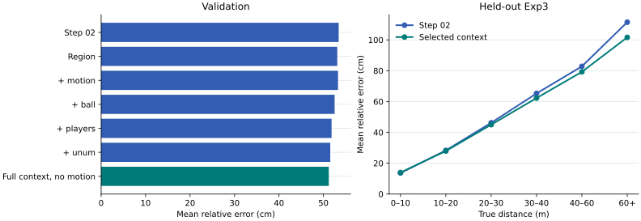

# Exp3 Step 07 — Uniform-number embedding and held-out test

A learned four-value embedding for uniform numbers 1–11 reduced validation
relative error from **51.83 to 51.54 cm** with the rest of the context
model held fixed. Each number indexes its own learned vector. Number 7 is
a category and has no prescribed numerical relation to number 2.

## Validation

The ball and player inputs come from prior observations. The uniform number
is shared across the two teams' embedding table. These games used the same
Helios policy on both sides, so the embedding may learn team-specific role
patterns. Cross-team generalization has not been measured.

| Method | Relative mean (cm) | Relative p90 (cm) |
|---|---:|---:|
| Step 02 GRU | 53.43 | 121.58 |
| Intersection only | 71.46 | 158.98 |
| Region GRU | 53.12 | 120.83 |
| Add learned displacement | 53.28 | 121.16 |
| Add ball | 52.52 | 118.52 |
| Add nearby players | 51.83 | 116.64 |
| Add uniform-number embedding | 51.54 | 115.74 |
| Full context without displacement head | 51.21 | 115.90 |

The best mean was **51.21 cm** with ball, nearby players and the embedding,
with the explicit displacement head disabled. The GRU still uses the eight
observations to learn a temporal correction. All learned variants used
seed 42, 18 epochs, 320 batches of 192 sampled windows per epoch, and the
same train and validation games. Model selection used the same stride-24
validation endpoints. These are single-seed ablations.

## Final held-out test

Test uses all **3,902,451** eligible endpoints from the
same 20 held-out games as Step 02. Only the validation-selected context
checkpoint enters the final test comparison. Every observation has equal
weight.

| Method | Relative mean (cm) | Relative p90 (cm) | Global mean (cm) | Global p90 (cm) |
|---|---:|---:|---:|---:|
| Fresh librcsc | 72.79 | 154.50 | 74.51 | 156.24 |
| Bounded blend | 67.72 | 150.79 | 69.43 | 152.43 |
| Intersection only | 67.69 | 150.78 | 69.40 | 152.42 |
| Step 02 GRU | 50.61 | 114.42 | 52.83 | 116.59 |
| Selected context GRU | 48.65 | 109.70 | 50.93 | 111.90 |

The selected model improved mean relative error from **50.61 to
48.65 cm** versus Step 02 (**3.9%**).
It improved **20 of 20 games**. Resampling the games
gives a 95% interval of **1.46 to 2.74 cm** for the mean gain.

| Test cohort | Observations | Step 02 mean / p90 (cm) | Context mean / p90 (cm) |
|---|---:|---:|---:|
| 0–10 m | 361,790 | 13.69 | 27.20 | 13.96 | 27.59 |
| 10–20 m | 1,038,001 | 28.29 | 56.97 | 27.93 | 56.68 |
| 20–30 m | 1,018,093 | 46.22 | 95.21 | 45.01 | 93.60 |
| 30–40 m | 714,649 | 65.28 | 134.95 | 62.26 | 130.30 |
| 40–60 m | 570,534 | 82.81 | 176.77 | 79.26 | 169.99 |
| 60+ m | 199,384 | 111.48 | 250.32 | 101.62 | 217.49 |
| Motion available | 2,368,970 | 34.26 | 75.25 | 33.48 | 73.44 |
| Motion missing | 1,533,481 | 75.87 | 159.78 | 72.09 | 151.91 |

[Step 06 · Nearby players](06-nearby-players.md) · [Step 08 · Normal-view replay](08-normal-view.md) · [Metrics](context-metrics.json)
