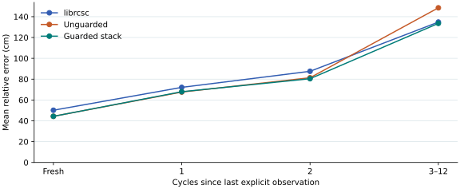

# Exp3 Step 13 — Close-range and observation-age gates

The selected normal-view stack reduced held-out mean relative position
error from **167.71 to 165.60 cm** across **2,000,986**
paired target-cycle observations. The reduction is **2.11 cm
(1.26%)**. These are offline normal-view results. Mean error improved in
**9 of 10 games**. A paired bootstrap that resamples whole games
gave a 95% interval of **1.40 to 2.67 cm** for the mean reduction.
Each resample preserves equal weight per scored target-cycle.

We tested a close-range gate that protects fresh estimates under 10 m.
That change helped the close cohort but was insufficient by itself.
The final gate also uses librcsc at estimated distances of at least
25 m when the track has had no recent update in the current cycle.
The gate was fixed on validation before applying it to the test set.
The thresholds use estimated distance and tracker age. Truth distance
is used only for the distance breakdown.

| Method | Scored rows | Relative mean (cm) | Relative p90 (cm) | Global mean (cm) |
|---|---:|---:|---:|---:|
| librcsc | 2,000,986 | 167.71 | 329.36 | 157.85 |
| Associated stack without gate | 2,000,986 | 171.04 | 345.99 | 161.47 |
| Close-range gate | 2,000,986 | 170.96 | 345.98 | 161.39 |
| Close-range and age/distance gates | 2,000,986 | 165.60 | 327.94 | 155.76 |

| Cohort | librcsc mean (cm) | Final stack mean (cm) |
|---|---:|---:|
| Fresh explicit observation | 50.16 | 44.31 |
| One cycle since explicit observation | 72.12 | 67.94 |
| Two cycles since explicit observation | 87.54 | 80.43 |
| 3–12 cycles since explicit observation | 134.80 | 133.55 |
| Under 10 m true distance | 109.30 | 104.15 |
| At least 40 m true distance | 270.96 | 271.12 |

The guarded stack is the best measured normal-view policy so far. The
stronger result is on fresh identified observations. The all-cycle gain
is small because stale prediction still depends on librcsc fallbacks.
The next improvement should target stale motion, using librcsc's tracked
velocity and position as a competing prior or testing directional
reachability. The model has not been integrated into the live team.

[Step 12 · Identity recovery](12-identity-recovery.md) · [Full validation and test metrics](normal-view-steps.json) · [Step 14 · Directional reachability](14-directional-reachability.md)
