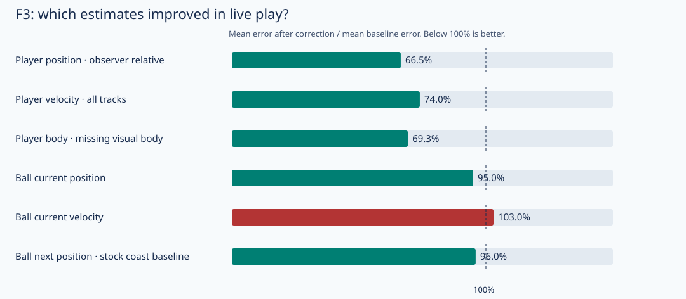
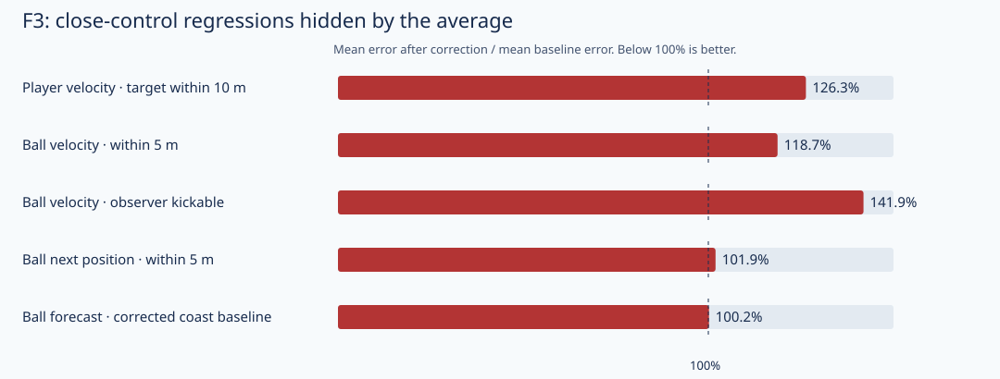

# Exp4 Step 03 — F3 live audit: real player gains, unsafe combined ball integration

**The player improvements reached the live team. The combined Exp4 treatment is not validated as an upgrade.** Ball velocity became worse in every one of the 155 scored games, close-control estimates regressed, and different parts of interception use different ball trajectories. Increasing the network size or simply running more matches is not the next useful step.

This audit checks all 155 completed F3 games and all 11 observers on each side. It uses PlayOn decisions only, with one equal weight per eligible observer–target–cycle. Fullstate is an evaluation reference, never a model input. Runtime code, model weights and launcher flags were not changed by this investigation.

## 1. What actually ran

Source player logs: `/home/nader/workspace/denoise/logs/exp3-f3-logs`. Score files: `/home/nader/workspace/denoise/AutoTest2D/out/exp3-f3-logs/result.d`.

There are 160 player-log game directories, of which 155 have a completed scored result; five unscored directories are excluded. All 3,410 agent metadata files in the scored games are final and marked OK. The configuration checks found no discrepancy:

| Setting | Verified live setting |
|---|---|
| Left team | Step 26 position apply + corrected routing + Exp4 state apply |
| Right team | Both model systems off; default legacy routing is inert |
| Vision | Quantized, high quality, 360° every cycle |
| Identity | Uniform-number fading disabled; ordinary motion/body fading retained |
| Hearing | Disabled, say message size 0 |
| Quantization | Distance step 0.1; noise-free and Gaussian modes off |
| Fullstate | Reference logging; not used for decisions |

Every logged PlayOn decision used a see update: 8,294,280 left and 8,296,475 right decisions. This does **not** mean every field is visible: 44.6% of eligible player rows lacked a raw body/motion reading. Seeing a player at age zero does not guarantee receiving its velocity and body.

The left side applied 164,430,735 player-position corrections, 164,446,296 player-state estimates and 7,830,776 ball-state estimates. The right side applied none. On eligible records, applied velocities and ball positions matched the final tracked fields within 0.0002 of their units; no reported visual body angle was overwritten. The models were active.

## 2. Match results and previous batches

| Batch | Left treatment vs stock right | Games | Goals | W–D–L | Left share of decisive wins |
|---|---|---:|---:|---:|---:|
| Original Exp3 | Stock | 200 | 795–796 | 81–38–81 | 50.0% |
| F1 | Step 26, legacy routing | 200 | 816–807 | 85–34–81 | 51.2% |
| F2 | Step 26, corrected routing | 100 | 386–359 | 43–17–40 | 51.8% |
| F3 | Step 26 corrected + all Exp4 outputs | 155 | 671–671 | 59–22–74 | 44.4% |

F3 reproduces the supplied score exactly: points 199–244. Equal goals do not imply equal results: there were 32 one-goal losses but only 14 one-goal wins. The team's wins were larger on average, masking the greater number of losses.

For F3, a whole-game bootstrap gives a goal-margin interval of −0.426 to +0.426 goals/game, and a points-difference interval of −0.735 to +0.155 points/game. These include zero. The observed result is disappointing and supplies no evidence of a match advantage; it does not establish the exact causal win-rate penalty. Target rows are correlated within games and must not be treated as millions of independent match trials.

Earlier batches use saved reports where raw logs were removed. The batches are different matches, treatment was always left, and F3 enabled several components together. Differences between F2 and F3 cannot isolate which component changed the score.

## 3. The player denoising result survived live deployment

| Metric | Unit | Mean: baseline → applied | p90: baseline → applied |
|---|---|---:|---:|
| Player position, observer relative | cm | 78.41 → 52.12 | 166.25 → 119.25 |
| Player position, global | cm | 80.29 → 54.63 | 168.25 → 121.75 |
| Player velocity | cm/cycle | 10.39 → 7.69 | 25.25 → 14.75 |
| Player body, reported + inferred | degrees | 24.21 → 16.83 | 89.65 → 56.95 |
| Player body, no visual body reading | degrees | 53.86 → 37.32 | 137.65 → 101.45 |
| Player body, visual body reported | degrees | 0.33 → 0.33 | 0.65 → 0.65 |

The relative-position metric evaluates the target offset from the observer in the observer's estimated looking frame; the global metric also includes observer pose error. Both compare paired estimates to the same cycle's reference. For missing stock velocity the evaluation fallback is zero; for unavailable stock body it is estimated movement direction, matching the offline evaluator.

Player relative error improved by **33.5%**, closely matching F1's 78.66 → 52.33 cm and F2's 79.06 → 52.75 cm. Position, player velocity and gated body mean errors improved in **all 155 games**. The primary player-position model has not stopped working.



A lower mean is not a guarantee on each sample. Player position became worse on 32.6% of corrections, by more than 50 cm on 3.74%, and by more than 1 m on 0.56%. Player velocity became worse on 40.6%; for inferred body, 35.1% became worse. These figures explain why a mean-error objective needs action-sensitive safeguards.

## 4. Close interactions reveal important regressions

Velocity entries below are cm/cycle.

| Situation | Mean baseline → applied | Individual rows made worse |
|---|---:|---:|
| Player velocity, observer–target <10 m | 3.32 → 4.20 | 62.3% |
| Player velocity, 10–40 m | 10.47 → 7.32 | 33.9% |
| Player velocity, ≥40 m | 12.57 → 9.91 | 52.1% |
| Player velocity, target <2 m from ball | 13.72 → 10.24 | 40.7% |
| Ball velocity, observer–ball <5 m | 4.23 → 5.03 | 62.8% |
| Ball velocity, observer can kick | 3.81 → 5.41 | 72.1% |

Under 10 m, player velocity was already accurate and worsened by 26.3%. Body readings in this distance group were preserved and remain about 0.33° error. At longer distances the velocity and missing-body models help substantially.

For the ball, the observer-kickable velocity error increased **41.9%**, with 72.1% of those corrections making the estimate worse. Current ball-position error in that group changed only 3.16 → 3.20 cm. The critical regression is velocity, rather than a large positional shift at the foot.



A separate geometric-control diagnostic on eight evenly spaced scored games, observer 2 on the left, covers 775,257 target rows. It uses each target's player-type kickable radius and fullstate geometry; it is not the planner's buffered kickability rule.

| Geometric classification error | Before corrections | After player + ball corrections |
|---|---:|---:|
| Falsely says another player is in kicking range | 5,564 | 3,168 |
| Misses a player truly in kicking range | 2,553 | 4,392 |

Corrections reduce false alarms but increase misses. Of 5,131 classification changes, 2,844 fix a wrong label and 2,287 break a correct one. This is a real tradeoff in the user's earlier concern about moving a player across the ball-control boundary. It does not tell us which specific goals resulted.

## 5. The live ball gains are much smaller than the offline report

| Metric | Unit | Mean baseline → applied | p90 baseline → applied |
|---|---|---:|---:|
| Current ball position | cm | 75.18 → 71.42 | 163.25 → 152.75 |
| Current ball velocity | cm/cycle | 31.84 → 32.80 | 88.25 → 92.25 |
| Next-cycle ball position | cm | 93.87 → 90.09 | 205.75 → 198.75 |
| Next-cycle ball velocity | cm/cycle | 43.02 → 41.81 | 125.75 → 115.25 |

The next-cycle baseline here is the **pre-apply current state extrapolated by ordinary ball decay**, evaluated against the actual next consecutive PlayOn cycle. There are 7,765,920 paired forecasts. Current-state metrics use 7,830,776 eligible rows.

Offline, the selected ball models had reduced position 68.75 → 63.98 cm, velocity 27.63 → 21.50 cm/cycle, next position 87.02 → 80.81 cm and next velocity 40.59 → 33.97 cm/cycle. Live current velocity instead became **3.0% worse**. This happened in **every one of the 155 games**, so it is not an isolated bad match.

The fairer test of the *extra forecast head* compares it with simply coasting from the already corrected current position and velocity:

| Situation | Corrected-current coast → learned next position, cm |
|---|---:|
| All paired next cycles | 89.94 → 90.09 |
| Estimated free ball | 81.73 → 83.26 |
| Estimated possible kicker | 104.59 → 102.28 |
| Next step actually coasts | 81.35 → 82.62 |
| Next step has a velocity impulse | 128.97 → 124.03 |
| Observer–ball <5 m | 31.09 → 31.79 |

Overall the next-position head adds no average gain over corrected-current coasting: **89.93 → 90.09 cm**. It helps on actual impulses and estimated possible-control situations, but hurts on ordinary coasting, estimated free-ball situations and close to the observer. The velocity-impulse categories use a reference change above 0.2 m/cycle and include collisions and tackles as well as kicks. They are evaluation categories, not information available before the event.

## 6. Why offline success did not transfer: additional replay checks

The existing frozen Python models were replayed on eight evenly spaced new F3 games, using untreated right observer 2. This is 36,620 ball rows and 96,934 sampled player rows; player sampling uses stride eight.

| Untreated F3 replay | Baseline → frozen model |
|---|---:|
| Player velocity | 10.14 → 7.43 cm/cycle |
| Gated player body | 22.96 → 15.26° |
| Ball position, quantized model | 68.91 → 62.51 cm |
| Ball velocity, expert model | 26.82 → 21.66 cm/cycle |
| Ball next position, expert model | 86.15 → 78.08 cm |
| Ball next velocity, expert model | 39.18 → 33.33 cm/cycle |

Thus the saved models still work offline on new matches from this batch. The historical offline improvement was real, but it measured stock-input histories rather than the full applied system.

An approximate replay of the same eight games' **left pre-apply snapshots** gives ball expert velocity **28.41 → 28.80 cm/cycle**, reproducing the wrong direction. Mean differences between this Python reconstruction and logged C++ output are 0.55 cm/cycle for current velocity, 0.80 cm for next position and 0.50 cm/cycle for next velocity. Estimate ages and the observer kickability cue are logged after application, so this reconstruction is not an exact parity test and should not be presented as one.

In that left sample, ball velocity with raw motion available is 9.96 → 9.97 cm/cycle; without raw motion it is 57.19 → 58.67 cm/cycle. The live pipeline fails precisely where it hoped to reconstruct missing information.

A separate feature-builder check on 4,989 continuous windows from one untreated right observer found features within 0.000001 and baselines within 0.000004 of Python. Context/owner choices differed on eight windows, consistent with a nearest-neighbor boundary sensitive to precision. This check excludes the quantizer geometry and does not establish exact parity for every live field. Together with the earlier 900-input network check, it argues against a large universal export/sign/units error. Closed-loop state feedback remains a stronger explanation.

## 7. Concrete code problems and design weaknesses

### A. The interception pipeline uses two ball trajectories

The active self-intercept solver is `InterceptSimulatorSelfV17`. It computes reach candidates from current `ball.pos()`, current velocity and decay, with its existing opponent-control special case. However `BallObject::inertiaPoint()` switches to the learned next-position/velocity forecast, and both the Helios intercept evaluator and `Body_Intercept2018::doFirstTurn()` use that function.

Consequently an action can be simulated for trajectory A, ranked for trajectory B and turned toward B. This inconsistency should have been resolved before treating the combined integration as ready for a scored test.

Across paired live rows, learned next position differs from corrected-current coasting by **23.52 cm on average**. The two corresponding five-cycle coasting paths differ by **44.64 cm on average**. These are path disagreements, not errors versus future fullstate; intentional action anticipation can create a difference, but the reach solver and action executor must agree on the path being tested.

Source anchors:

- `librcsc-denoise/rcsc/player/intercept_table.cpp:67`: active self solver.
- `librcsc-denoise/rcsc/player/intercept_simulator_self_v17.cpp:217`, `:1067`, `:1331`: current-state extrapolation.
- `librcsc-denoise/rcsc/player/ball_object.h:458`: learned forecast in inertia queries.
- `helios-base-denoise/src/player/intercept_evaluator_sample.cpp:121`: candidate evaluation.
- `helios-base-denoise/src/player/basic_actions/body_intercept2018.cpp:223`: first-turn target.

### B. Corrected state feeds later estimation, unlike the offline training histories

`world_model.cpp:2928` writes corrected ball position, relative position and velocity into the ordinary BallObject. Later localization uses previous relative positions and velocities, including `estimateBallVelByPosDiff()` at lines 2584 and 2623. In player state, inferred velocity/body are also written back and their ages capped at one at lines 2943–2949.

The variable called “stock” is therefore only **before this cycle's correction**. It is not the result of an untouched librcsc observer running in parallel. Earlier corrections can already have changed it. This creates an input distribution absent from stock-data training and can make inferred estimates appear more recent/valid in subsequent cycles.

The eight-game replay contrast supports this feedback concern. Match behavior and viewing geometry also change, so the logs alone cannot apportion the regression exactly between feedback and changed trajectories. An independent stock estimator or a deterministic closed-loop replay is needed for that attribution.

### C. The ball is assembled from independently trained outputs

`sample_player.cpp:252–257` takes current ball position from the quantization model and current velocity plus future state from the expert model. Those outputs were not trained jointly with the self-intercept and kick planner. There is no constraint ensuring that the selected current and next states describe a consistent motion hypothesis.

The ball correction also replaces relative ball position by corrected global position minus estimated self position. Near the ball this changes inputs to kick rate and kickability (`self_object.cpp:1056–1068`) and can feed back into the next velocity estimate. The measured near-ball regressions justify guarding this path even though mean global position improved.

### D. Better average estimates do not calibrate decision safety

The pass/dribble safety margins remain the stock ones, and point estimates do not communicate uncertainty. Lower mean player error does not mean each defender is reliably closer or farther, or that a learned future action will happen. The geometric miss/false-alarm tradeoff above is measurable evidence; a specific claim that margins caused lost games would require action-level analysis.

Decision latency also rises: left median/p95/p99 are approximately **19.5/30.5/34.5 ms**, versus right **10.5/19.5/23.5 ms**. These are 1 ms histogram estimates of sense-body-to-decision time, not network-only inference timings. The logs show all sampled PlayOn decisions used see updates; they do not by themselves prove every command met the server deadline.

## 8. Recommended next step

1. **Keep Step 26 as the established player-position result.** Do not describe the full F3 package as the best validated live solution.
2. **Repair the integration before training a larger model.** Give interception one consistent trajectory. The safest diagnostic is to stop overriding ordinary inertia queries with learned forecasts while continuing to log the candidates.
3. **Separate sensor history from applied decision state.** Reconstruct models from an immutable stock observation history, or train/evaluate the actual feedback loop. Preserve observed body angles; do not equate a neural estimate with a fresh sensor measurement.
4. **Guard already accurate close-range estimates.** Ball current velocity near the kicking player and player velocity under 10 m should remain stock until a validated gate demonstrates benefit. A held-out gate must be evaluated by range, raw-motion availability and action regime.
5. **Run component ablations with sides swapped.** Start Step 26 alone, then guarded player velocity/body; test ball position separately; test ball velocity and forecasting last. Log interception reach residuals, successful kicks, possession-boundary mistakes and action deadlines alongside noise. Compare identical configurations and, where possible, common initial seeds.

A reduction from 78 to 52 cm player error does not imply a 75% win rate: much of the average comes from distant targets, and decisive close-control errors can regress while the global average improves. The available evidence supports a useful player denoiser, a failed live ball-velocity transfer, and an inconsistent combined planning integration. It does not support solving this by match count alone.

## Reproduce and retained evidence

Run from the server repository using the existing Exp2/Exp4 Python environment:

```sh
python3 experiments/exp4/reporting/audit_live.py   ../logs/exp3-f3-logs ../AutoTest2D/out/exp3-f3-logs   ../logs/exp4/f3-audit.json --workers 24

python3 experiments/exp4/reporting/replay_control.py   ../logs/exp3-f3-logs ../AutoTest2D/out/exp3-f3-logs   ../logs/exp4/runs ../logs/exp4/f3-control-replay.json

python3 experiments/exp4/reporting/replay_applied.py   ../logs/exp3-f3-logs ../logs/exp4/f3-control-replay.json   ../logs/exp4/runs ../logs/exp4/f3-apply-diagnostics.json
```

To regenerate the HTML after editing the Markdown, run:

```sh
python3 experiments/exp4/reporting/render_report.py experiments/exp4/reports/03-live-f3-audit.md
```

Retained lightweight evidence: [all-game metrics](f3/live-metrics.json), [untreated replay](f3/control-replay.json), [applied replay and geometry](f3/applied-replay.json), [feature check](f3/feature-parity.txt). p90 live values use histograms (0.5 cm bins, 0.1° angle bins). Means and event counts are accumulated directly. No raw logs or datasets are duplicated into the report.

Previous evidence: [Exp3 F1/F2 live results](../../exp3/reports/31-live-results.md), [Exp4 offline models](01-state-models.md), [integration design](02-live-integration.md).
