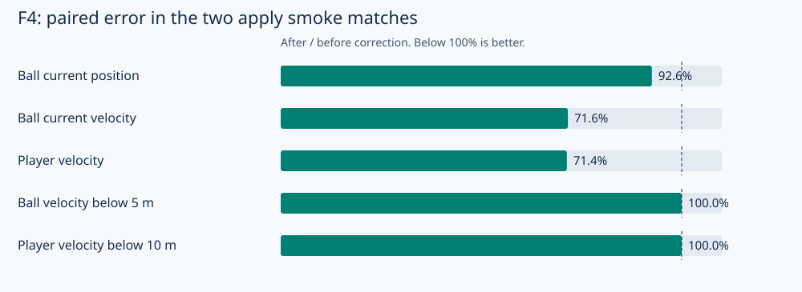

# Exp4 Step 04 — F4 live integration repair

**The ball velocity gain now appears in live smoke tests.** We kept the existing weights, isolated observation history from decision overrides, retained accurate close-range estimates and removed learned forecasts from physical inertia queries. Across two short apply matches, one on each side, current ball velocity error improved **31.66 → 22.67 cm/cycle**. These checks validate integration and paired noise reduction; they do not establish a match win-rate advantage.

## What changed

| Area | F3 behavior | F4 behavior |
|---|---|---|
| Temporal estimator history | Applied state could feed the next sensor update | Save stock ball state and player velocity/body/ages; restore after action construction, logging and debug output |
| Current ball state | Replace position and velocity on every eligible candidate | Keep stock position/velocity below 5 m raw range |
| Player velocity | Replace at every distance | Keep stock velocity below 10 m raw range |
| Player body | Preserve reported body, infer missing body | Same gate; restore original state/age before the next observation |
| Ball future path | Forecast affected inertia queries and other-player reach, while self solver used current state | Forecast is log-only; ordinary current-state/decay path is used, with native opponent-control exceptions retained |
| Controls | One combined state switch | Independent player/ball modes plus configurable range guards |
| Logging | One global application flag | Candidate values, individual applied flags, original ages, ownership cue and integration identifier |

The GRU still receives eight causal stock snapshots. Restoring the observation state does **not** discard the GRU history. Decision consumers see the applied estimates for the entire action, and the logger snapshots that same state before restoration. Fallback restoration also runs before prediction and referee mode changes.

The guard thresholds come from the F3 diagnostic. They are a conservative policy for the next experiment, not a newly trained or independently optimized gate. No fullstate enters the network or guards. The thresholds use raw observed range, so their boundary differs slightly from a true-distance category.

## Live verification

Four short synchronous 360° matches completed with all **88 agent logs finalized**:

| Smoke | Setup | Simulated cycles |
|---|---|---:|
| apply-01 | Guarded combined apply left, stock right | 1,200 |
| apply-right-01 | Stock left, guarded combined apply right | 1,200 |
| ball-only-01 | Step26 + guarded ball state left; Exp4 player state off | 600 |
| shadow-01 | Step26 on both; Exp4 shadow on both | 600 |

The following means pool the two combined apply matches, weighting each target-cycle equally. There are 21,446 paired ball rows and 450,366 player-state rows.

| Metric | Unit | Stock before this correction | Actually used after guards |
|---|---|---:|---:|
| Step26 player position, observer relative | cm | 80.11 | 52.78 |
| Ball position | cm | 75.87 | 70.23 |
| Ball velocity | cm/cycle | 31.66 | 22.67 |
| Player velocity | cm/cycle | 10.69 | 7.63 |
| Player body, reported + inferred | degrees | 26.06 | 16.67 |
| Ball velocity, raw range <5 m | cm/cycle | 4.15 | 4.15 |
| Player velocity, raw range <10 m | cm/cycle | 3.15 | 3.15 |



Ball velocity improved by **28.4%**. On the left apply smoke alone it was 30.24 → 22.42 cm/cycle; on the right apply smoke it was 32.92 → 22.90. The separate ball-only smoke gave 30.87 → 21.95 cm/cycle.

The close-range rows are identical before and after because those fields were deliberately preserved. The ungated model would still worsen near-ball velocity and near-player velocity. This is evidence that both the state-history repair and the guards are needed for this tested policy.

All tests reported:

- Zero current-state write mismatches.
- Zero range-guard violations.
- Zero reported body angles overwritten.
- Zero learned forecasts applied to inertia.
- Zero Exp4 writes in shadow mode.
- No Exp4 candidates on the untreated side, or player candidates when that component was off.

An explicit C++ regression check verifies restoration of stock ball state and player validity/counts, missing-input masks across consecutive corrections, the physical inertia formula, near-range guards, reported-body preservation, history gaps, noise-free rejection, shadow/component modes, and fresh warmup after a setplay restart.

Python reconstruction of live pre-apply inputs was checked on 867 left-frame and 977 right-frame ball windows. The 99th-percentile discrepancy in each output pair was below 0.000155 in metres or metres/cycle. A few larger discrepancies remain when reconstructing from rounded CSV values (maximum 0.0862 m for next/current position components); this is not a claim of exact full-precision input parity. All replay inputs are estimated state/raw observations; reference state supplies labels only.

## Running the next batch

The existing `--exp4-state apply` command now selects the repaired guarded policy. No new weights or training are needed. librcsc was built and installed to `/home/nader/local`; Helios was rebuilt in the existing build directory and links that installation.

Use a fresh log directory, for example `/home/nader/workspace/denoise/logs/exp3-f4-logs`. Keep the current Exp3 server configuration.

For the left team:

```sh
./start.sh -p "$PORT" -P "$OLCOACH_PORT" -t lt \
  --fullstate reference \
  --denoise-log-dir "$LOG_PATH" --denoise-game-id "$GAME_ID" \
  --player-position-denoise apply --player-position-model "$MODEL" \
  --player-position-routing corrected \
  --exp4-state apply --exp4-model-dir "/home/nader/workspace/denoise/logs/exp4/weights"
```

`MODEL` remains `/home/nader/workspace/denoise/logs/exp3-context-runs/step26-polar/player-position.weights`. Keep the right team's original command, with fullstate reference/logging and no denoising arguments.

Optional component controls:

| Added option | Effect |
|---|---|
| `--exp4-player-state off` | Keep Step26 and ball correction; disable Exp4 player velocity/body |
| `--exp4-ball-state shadow` | Apply player state; log ball candidates without using them |
| `--exp4-state shadow` | Log both Exp4 groups; keep their stock state for decisions |
| `--exp4-player-velocity-min-dist 10` | Default player velocity guard |
| `--exp4-ball-position-min-dist 5` | Default ball position guard |
| `--exp4-ball-velocity-min-dist 5` | Default ball velocity guard |

Components default to inheriting the overall mode. The model loaders and individual modes are validated by both launcher and player. Learned future ball outputs cannot be enabled as an inertia override in F4.

After a batch, summarize actual estimates separately from candidates:

```sh
cd /home/nader/workspace/denoise
python3 rcssserver-denoise/experiments/exp4/reporting/summarize_live.py \
  logs/exp3-f4-logs logs/exp4/f4-summary.json --workers 24
```

Schema 3 metadata identifies `exp4_integration=f4-isolated-observations` and each effective component mode. `exp4_pos_applied`, `exp4_vel_applied`, `exp4_body_applied` and `exp4_forecast_applied` distinguish usage. `trk_*` remains the actually used decision state. Use the new summarizer for F4; the F3 audit assumes its older global application behavior. General Exp1/Exp3 reporting readers also accept schema 3. Original Exp3 training builders still require their original schema-2 input data; applied decision tracks must not silently become new training inputs.

## Reproduce the verification

From the workspace root, in the existing Python environment:

```sh
exp=rcssserver-denoise/experiments/exp4
g++ -std=c++17 -O2 -fno-access-control -I/home/nader/local/include \
  "$exp/verification/state_lifetime.cpp" -L/home/nader/local/lib \
  -Wl,-rpath,/home/nader/local/lib -lrcsc -lz -o /tmp/exp4-state-lifetime
/tmp/exp4-state-lifetime

# Use a new smoke name; existing outputs are never overwritten.
python3 "$exp/verification/run_smoke.py" apply-check --port 16340
python3 "$exp/reporting/summarize_live.py" \
  logs/exp4/live-f4/apply-check/dataset logs/exp4/live-f4/apply-check/summary.json
python3 "$exp/verification/replay_live.py" \
  logs/exp4/live-f4/apply-check/dataset/apply-check/l_2 \
  logs/exp4/runs logs/exp4/live-f4/apply-check/replay-l2.json
```

The regression executable uses compiler access control relaxation for its white-box fixture only; production binaries use ordinary compilation. Raw smoke logs are outside the repository under `logs/exp4/live-f4`. [Retained lightweight metrics and replay results](f4/verification.json).

[Previous F3 investigation](03-live-f3-audit.md) · [Original offline models](01-state-models.md)
