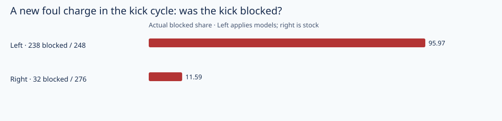
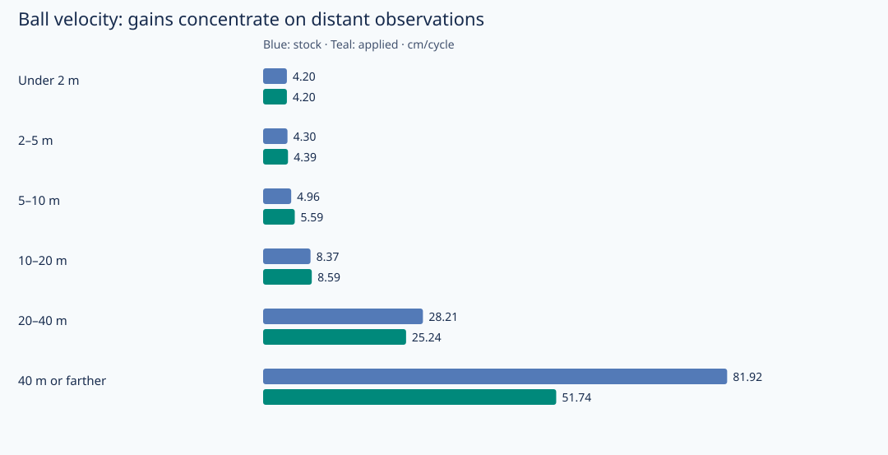
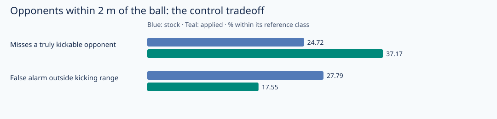

# Exp4 Step 05 — F4 audit of the first 60 scored games

**Noise reduction is real, but the team has a command-order disadvantage and remaining control errors.** Ball velocity improves 32.49 → 24.64 cm/cycle and player position 78.42 → 52.22 cm. Added decision time leaves kicks vulnerable to earlier foul commands: among simultaneous kicks with a new foul charge, 238/248 left kicks were blocked versus 32/276 right kicks. Better average positions also cause more misses of opponents who physically can kick.

This report freezes the exact 60 games matching the supplied result: **222–225 goals; 24 wins, 11 draws, 25 losses; 83–86 points**. Later games are excluded. The live code and running jobs were not changed by this audit.

## 1. Scope and configuration

All 1,320 finalized agent metadata files match F4: left Step26 corrected routing plus Exp4 player/ball apply, right off. Both sides use quantized high-quality 360° vision, preserved uniform numbers, ordinary motion/body fading, no hearing and reference-only fullstate. Forecasts are log-only.

The audit reads all 11 treatment observers and all 22 agents' command counters per game. It covers 3,042,366 paired ball estimates, 63,889,686 player-state estimates and 63,885,066 position corrections. Every logged PlayOn decision uses a see update. All 67,665,654 eligible player tracks have position count zero; velocity/body fields can still be missing.

There are zero current-state write mismatches, range-guard violations, reported body angles overwritten or learned forecasts applied.

Each eligible observer–target–cycle gets equal weight. “Stock” is before correction on the same treatment row; “applied” is the actual tracked state used for the decision. Fullstate supplies labels and evaluation groups only. Invalid stock velocity falls back to zero, and unavailable body to estimated movement direction, matching the offline evaluator.

## 2. Match outcome and a concrete command-order disadvantage

The goal margin is −0.05 goals/game, with a whole-game bootstrap 95% interval of **−0.65 to +0.57**. The points-difference interval is **−0.75 to +0.65 points/game**. This snapshot is close to a tie and supplies no reliable match advantage; it does not establish the estimates' causal effect on win rate.

| Sense-body to decision | Left, models applied | Right, stock |
|---|---:|---:|
| Median | 20.5 ms | 10.5 ms |
| p95 | 31.5 ms | 20.5 ms |
| p99 | 35.5 ms | 24.5 ms |

Finishing within a nominal cycle does not eliminate timing effects: the server handles some actions immediately on receipt.

### A foul can suppress a later kick in the same cycle

The source establishes the mechanism:

- <code>src/player.cpp:1305</code>: a kick returns if the player is already marked command-done.
- <code>src/referee.cpp:835</code>: a successful intentional-foul path charges a currently kickable opponent.
- <code>src/player.cpp:2792</code>: that charge marks the victim command-done.
- A kick already executed before the foul is not undone afterward.

Successful kicks are identified by the next consecutive sense-body kick-counter increment. The following restricts to players uncharged before the action who receive a **new charge** by the next cycle, with PlayOn in both rows.

| Same-cycle kick plus new foul charge | Left | Right |
|---|---:|---:|
| Such kick events | 248 | 276 |
| Kick executed | 10 | 244 |
| Kick blocked | **238** | **32** |
| Blocked share | **95.97%** | **11.59%** |

Every event has an opponent's intentional-foul command in the same cycle. Intentional foul attempts are similar overall: 737 left and 709 right. Here “charge” means the server's temporary victim freeze, including undetected fouls; it does not necessarily mean a referee awarded a free kick.



Twelve illustrative raw-send traces restricted to these verified charge events agree with the mechanism. Failed kicks were sent after the foul command, or within the same millisecond; successful kicks were sent before it, or within the same millisecond. Same-millisecond traces cannot establish ordering.

Example: game <code>202611141919_1097</code>, cycle 1606. Left player 10 was 0.729 m from the ball, inside its 1.037 m kickable radius. Right player 4 sent an intentional tackle **7 ms before** the left kick. The next sense body shows charge expiry 4 and no kick-counter increment. The ball was not out of range.

Across all paired kick commands:

| No successful-kick acknowledgement | Left | Right |
|---|---:|---:|
| Total | 245 / 33,203 | 44 / 33,615 |
| Associated with a new foul charge | 238 | 32 |
| Physically outside kicking range | 7 | 12 |

Dash/turn acknowledgements are overwhelmingly present: 24/2 left/right dash misses and 6/0 turn misses among millions. A broad deadline or packet-loss failure is not supported by these counts.

**Interpretation:** extra computation creates a strong within-cycle ordering vulnerability. Decisions also change positions and tackle probabilities; a time-matched control or faster inference is needed to isolate the full effect. These counts cannot be converted directly into lost goals.

The retained 100 F2 games already show a smaller asymmetry. Step26-only left had 283/55,889 unacknowledged kicks versus 177/54,098 right. Among simultaneous foul **attempts** and physically in-range kicks, blocked shares were 60.0% left and 31.2% right; F4 gives 83.5% and 10.0%. This broader comparison includes unsuccessful foul attempts, unlike the new-charge table above. Different batches limit causal comparison.

## 3. Average noise: the deployment repair is holding

| Metric | Unit | Mean stock → applied | p90 stock → applied |
|---|---|---:|---:|
| Player position, observer-relative | cm | 78.42 → 52.22 | 165.75 → 119.75 |
| Player velocity | cm/cycle | 10.43 → 7.57 | 25.25 → 14.75 |
| Player body | degrees | 25.17 → 16.98 | 90.55 → 57.35 |
| Ball position | cm | 75.17 → 69.92 | 163.25 → 150.75 |
| Ball velocity | cm/cycle | 32.49 → 24.64 | 76.75 → 51.25 |

Each overall mean improves in **all 60 games**. F3's saved report had ball velocity worsening 31.84 → 32.80 cm/cycle; F4 now improves 32.49 → 24.64. Player-position improvement remains similar. These are different games, so paired within-batch effects are the defensible comparison.

Individual corrections still worsen ball position on 42.3% of rows, ball velocity on 37.5%, player position on 32.7% and player velocity on 35.6%. Position error increases above 50 cm occur on 3.64% of ball rows and 3.73% of player rows.

## 4. Ball near the observer: what matters for kicking

When the observer estimates it can kick, F4 retains stock ball state:

| Quantity at the foot | Current mean error |
|---|---:|
| Global ball position | 3.14 cm |
| Ball–self range | 2.57 cm |
| Ball bearing relative to body | 0.457° |
| Ball velocity | 3.81 cm/cycle |

Self-position error is 1.52 cm in this 360° batch and is unchanged by F4; it contributes to global ball coordinates. The relative range and bearing are more direct kick-geometry measures.

These applied values are unchanged. The ungated velocity candidate would worsen error to **5.39 cm/cycle**. The close-range guard is useful.

Range and body-relative bearing drive kick efficiency more directly than global position. A separate observer-2 diagnostic on 579 estimated-kickable rows gives **1.20% mean relative kick-efficiency error** from geometry, with no error above 5% in that subset. This is an evaluation, not a learned gain.

The actual command-aware next-ball prediction after an observer sends a kick has **16.01 cm position error and 13.45 cm/cycle velocity error** on 31,333 eligible paired rows. It includes the queued kick. Actuator randomness, collisions, simultaneous actions and suppressed kicks affect this residual.

Distant-observer denoising does not directly improve these already accurate foot estimates, or prevent an earlier foul from blocking the command.

## 5. Distance: the largest ball gains are far away

Position is cm; velocity is cm/cycle.

| True observer–ball distance | Position stock → applied | Velocity stock → applied |
|---|---:|---:|
| Under 2 m | 3.72 → 3.72 | 4.20 → 4.20 |
| 2–5 m | 9.60 → 9.74 | 4.30 → 4.39 |
| 5–10 m | 20.34 → 20.58 | 4.96 → 5.59 |
| 10–20 m | 41.84 → 40.50 | 8.37 → 8.59 |
| 20–40 m | 77.83 → 71.89 | 28.21 → 25.24 |
| 40 m or farther | 140.94 → 129.75 | 81.92 → 51.74 |



Current velocity slightly worsens at **5–20 m**; position slightly worsens at 5–10 m. Without raw motion, velocity improves **65.94 → 46.53 cm/cycle**. With raw motion, it changes **9.49 → 9.58**. Much of the global gain fills missing distant motion while disturbing some accurate measured velocities.

Evaluation bins use true distance. The guard uses rounded observed distance; a few true 2–5 m rows cross its raw 5 m boundary and are corrected. That explains their small changes without a guard violation.

## 6. Other players controlling or kicking the ball

“Physically in range” uses reference geometry and the player's heterogeneous kickable radius. It does not assert intent to kick. Groups overlap.

A kick event comes from the kicker's own counter. “First observation after” means the observation where the result of that accepted command first appears. Another kick or a cycle gap resets the age.

| Situation | Ball position stock → applied, cm | Ball velocity stock → applied, cm/cycle |
|---|---:|---:|
| Opponent physically in kicking range | 67.63 → 66.03 | 24.40 → 21.04 |
| Another teammate physically in range | 89.75 → 78.51 | 30.87 → 24.76 |
| Nobody physically in range | 75.31 → 70.35 | 35.06 → 25.80 |
| First observation after another player kicks | 77.05 → 71.41 | 38.53 → 32.59 |
| One further cycle after that kick | 78.02 → 71.48 | 35.44 → 26.52 |
| Two–three further cycles | 77.32 → 70.68 | 31.77 → 22.62 |
| First after kick, observer within 10 m | 17.87 → 18.31 | 4.80 → 5.56 |
| First after kick, observer 10 m or farther | 84.24 → 77.86 | 42.62 → 35.88 |

First-post-kick estimates improve overall, but less than subsequent cycles. Within 10 m at that first observation, velocity instead worsens **4.80 → 5.56 cm/cycle**. This is a small absolute regression in a tactically relevant group.

For extrapolation to the next cycle:

| Situation | Stock coast → applied-state coast position error, cm |
|---|---:|
| All paired next cycles | 94.50 → 87.07 |
| Opponent physically in kicking range now | 107.97 → 104.40 |
| Another player actually kicks next cycle | 125.16 → 116.94 |
| No other player kicks next cycle | 86.09 → 78.88 |

These are errors against the actual future, not pure sensor noise. An unknown future kick can dominate them. Current-state denoising cannot remove all that uncertainty. These coasting diagnostics also omit the observer's own queued action; use the command-aware measure in section 4 for its kick behavior.

The learned next-position candidate is **87.75 cm** overall versus **87.07 cm** for coasting from the actual current state. It stays log-only; restoring its old global inertia override is not justified by these means.

## 7. Players, ball carriers and confidence

| Situation | Position error, cm | Velocity error, cm/cycle | Body error, degrees |
|---|---:|---:|---:|
| Observer–target below 10 m | 18.04 → 13.54 | 3.33 → 3.32 | 0.33 → 0.33 |
| 10–40 m | 64.12 → 43.88 | 10.53 → 7.34 | 13.57 → 9.68 |
| 40 m or farther | 139.10 → 88.78 | 12.57 → 9.67 | 66.17 → 43.14 |
| Target within 2 m of ball | 76.41 → 55.01 | 13.65 → 9.92 | 18.26 → 13.12 |
| Target physically kickable | 75.64 → 55.41 | 13.30 → 10.05 | 19.17 → 14.59 |
| Target just kicked | 74.76 → 54.68 | 8.86 → 7.88 | 22.15 → 16.17 |

Reported body readings remain about 0.33°. Without a raw body reading, error improves **55.92 → 37.59°**, still substantial uncertainty.

In the observer-2 diagnostic, 214,200 rows change from unavailable stock body to valid inferred direction. This subset has **59.54° mean error**, with **49.4% above 45°**. It represents 3.69% of that diagnostic's target rows, not all inferred directions. A temporary decision age of one should not imply sensor-like confidence for this subset.

## 8. Better positions can miss who is able to kick

This test compares stock/corrected player–ball geometry using actual heterogeneous radii. It is a physical-range proxy, not a replay of planner buffers, player-type uncertainty or all tactical rules.

For opponents within 2 m of the true ball:

| Classification error | Stock | Applied |
|---|---:|---:|
| Miss a truly kickable opponent | **24.72%** | **37.17%** |
| False alarm on an out-of-range opponent | 27.79% | **17.55%** |

The first percentage is conditional on truly kickable opponents; the second on the other nearby opponents. Across all players, misses rise 217,058 → 347,038 while false alarms fall 424,673 → 254,980.



Mean relative player–ball geometry improves 87.24 → 74.98 cm for targets within 2 m of the ball, yet boundary decisions improve little. Within 30 cm of the kicking boundary, total misclassification changes only **37.13% → 36.67%**.

In the observer-2 diagnostic, when a target truly can kick, estimated player–ball distance has positive bias **17.41 cm stock versus 29.46 cm applied**. The corrected point estimate more often places a real carrier outside the control radius. Joint relative geometry or calibrated control probability is a more useful next objective than global x/y error alone.

## 9. Recommended priorities

1. **Address action timing first.** Make inference cheaper and measure arrival order. A dedicated time-matched stock-decision control can separate perception benefit from computation cost. Changing the official server's foul rules tests a different game.
2. Validate ball gates for **5–20 m and the first post-kick observation**, preserving measured motion where already accurate.
3. Calibrate **joint ball-control decisions and missed threats**, including uncertainty or control probability.
4. Keep newly inferred, unreliable body directions uncertain.
5. Repeat component tests with treatment sides swapped, reporting command execution and control mistakes alongside noise and goals.

A bigger network could worsen the timing problem. The next improvement should target the measured failure mechanisms.

## Reproduction and retained evidence

Evidence: [frozen selection](f4-60/selection.json), [all-observer metrics](f4-60/situations.json), [control/validity diagnostic](f4-60/control-geometry.json), [kick commands](f4-60/kick-commands.json), [new foul charges](f4-60/foul-timing.json), [raw-send traces](f4-60/arrival-order.json), [F2 comparison](f4-60/f2-kick-commands.json).

From the workspace root in the existing Python environment:

```sh
code=rcssserver-denoise/experiments/exp4/reporting
# Use a new filename to freeze later completed games; incomplete games are skipped.
python3 "$code/select_completed.py" logs/exp3-f4-logs AutoTest2D/out/exp3-f4-logs logs/exp4/f4-new-selection.json

python3 "$code/audit_situations.py" logs/exp3-f4-logs logs/exp4/f4-60-selection.json logs/exp4/f4-60-situations.json --workers 16
python3 "$code/audit_control_geometry.py" logs/exp3-f4-logs logs/exp4/f4-60-selection.json logs/exp4/f4-60-control-geometry.json
python3 "$code/audit_kick_commands.py" logs/exp3-f4-logs logs/exp4/f4-60-kick-commands.json --selection logs/exp4/f4-60-selection.json
python3 "$code/audit_foul_timing.py" logs/exp3-f4-logs logs/exp4/f4-60-selection.json logs/exp4/f4-60-foul-timing.json
python3 "$code/trace_action_order.py" logs/exp3-f4-logs logs/exp4/f4-60-selection.json logs/exp4/f4-60-arrival-order.json --events logs/exp4/f4-60-foul-timing.json --per-category 3
```

Means/counts are accumulated directly. p90 values use 0.5 cm spatial and 0.1° angular bins. Decision latency uses 1 ms bins. Counter comparisons require consecutive PlayOn command/next rows. New-charge analysis excludes already-charged victims. Raw traces are illustrative, not a randomized estimate of all packet arrivals; equal-millisecond clock values are unresolved.

[Previous F4 repair](04-live-f4-fix.md) · [F3 investigation](03-live-f3-audit.md)
