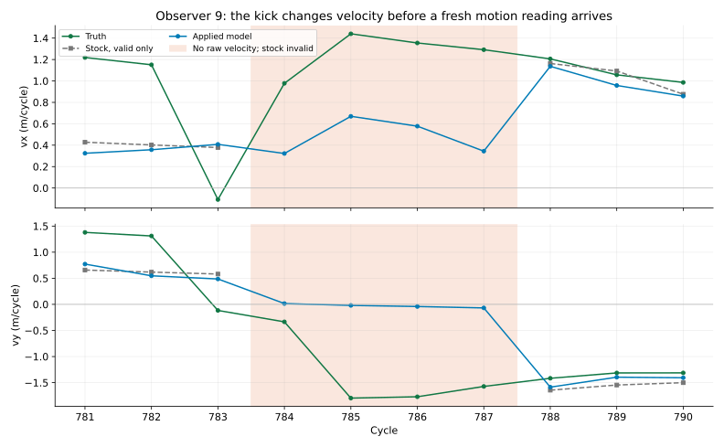
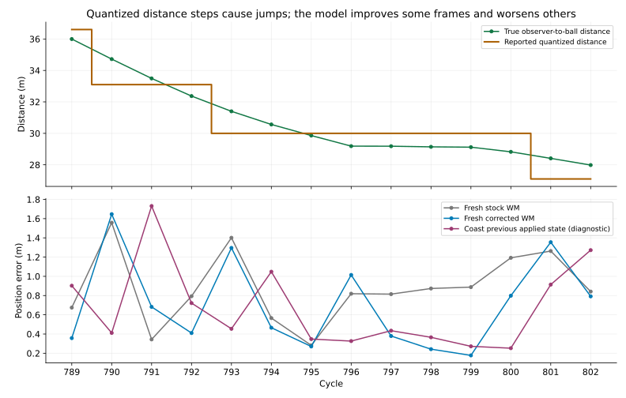
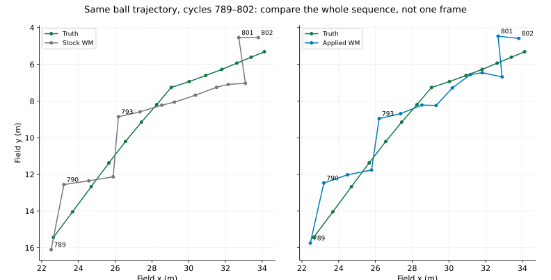

# Exp4 step 09 · Closeout: better averages, unresolved ball dynamics

2026-11-15 · Quantized 360° observations · No runtime changes in this audit

## Decision

**Close this research phase with player-position denoising as the strongest
deployment candidate. Do not promote the combined ball correction as a
reliably better game state yet.**

The player-position model consistently reduces mean error by about one third
in offline and live comparisons. Adding ball models improves overall mean
error after the F4 repair, but it does not reliably handle missing motion
fields, kicks, quantization-bin transitions or the temporal consistency
needed by decisions. The screenshots identify real examples of these gaps.

This is a deployment recommendation, not proof that ball denoising always
hurts or that player denoising has established a match win-rate benefit.
The existing batches do not isolate ball-on versus ball-off under an otherwise
identical randomized scheduling condition.

## What we learned across the experiment

| Stage | What worked | Limit or failure |
|---|---|---|
| Exp3 Step26 player position | Live relative mean error approximately 79 → 53 cm; corrected positions reach decision checks | Some individual corrections worsen; a large win-rate gain was not established |
| Exp4 offline player velocity/body | History plus context improves aggregate error | Learned body/velocity must preserve observed fields and validity semantics |
| Exp4 offline ball state/forecast | Quantization constraints and context improve held-out metrics | Offline accuracy did not ensure safe combined live behavior |
| F3 combined live integration, 155 games | Player-position improvement persisted | Ball velocity worsened 31.84 → 32.80 cm/cycle; history feedback and ball-path integration needed repair |
| F4 repair | Separate observation history, close-range guards and log-only forecasts restored live average gains | Difficult post-kick/control cases remained |
| Server scheduling control | Complete-cycle random player priority removes the identified receive-speed advantage | A changed scheduling condition must be reported separately from standard-server games |
| Visual inspection, this report | Confirmed the ball's missing-velocity and position-jump failure modes against CSVs and fullstate | Improving averages is insufficient to guarantee a coherent trajectory or better decisions |

[F1/F2 live player-position results](../../exp3/reports/31-live-results.md) ·
[F3 audit](03-live-f3-audit.md) · [F4 repair](04-live-f4-fix.md) ·
[F4 60-game audit](05-live-f4-60-games.md) ·
[Random scheduling](06-server-command-order.md)

## Overall accuracy: useful gains, not a guarantee for every frame

The randomized-priority first-15-game report sampled two rotating treatment
observers and one stock observer per game. Each eligible observer–target–cycle
had equal weight. These are saved measurements from that report, not a new
full-batch noise calculation.

| Mean error | Stock | Applied | Individual applied estimates worse |
|---|---:|---:|---:|
| Player position, observer-relative | 78.91 cm | 52.96 cm | 33.0% |
| Player velocity | 10.14 cm/cycle | 7.48 cm/cycle | 37.0% |
| Player body direction | 25.63° | 17.17° | 14.9% |
| Ball position | 76.78 cm | 71.72 cm | 43.1% |
| Ball velocity | 32.41 cm/cycle | 24.83 cm/cycle | 38.2% |

Ball state within 5 m of the observer and player velocity within 10 m remain
stock. Reported player body angles are preserved. Those guards protect the
observer's nearby control; they do not protect a ball 40 m from this observer
that is being kicked by another player.

The earlier F4 60-game audit found gains in every game's overall means,
while also finding more missed physically kickable opponents and difficult
nearby post-kick cases. Those results explain why one global error number
does not fully describe decision quality.

[First-15 sample, exact scope and paired metrics](07-random-order-first15.md)

## Case 1 · Observer left 9, cycles 784–787

### The observation is fresh, but the velocity information is absent

The observer uses a see update in every cycle of 784–802. However, its ball
entries contain **distance and bearing only** during 784–787. Both motion
fields, dist_chg and dir_chg, are absent.

This is expected under the experiment configuration. For observer 9's
player type 0, ball motion fading starts at 20 m and reaches certain
omission at reported distance 40 m. The server computes the omission
probability from the reported noisy distance. The log reports 44.7 m at
784 and 40.4 m at 785–787. Retaining uniform numbers does not disable
this ball-velocity fading; see_no_fade_all remains false.

At cycle 787 the true distance is already 38.67 m, but the quantized report
is still 40.4 m, so motion fields are still omitted. At 788 the report
becomes 36.6 m and a motion reading is present.

**360° every cycle therefore does not mean a fresh velocity measurement
every cycle.** The ball is seen, while its velocity can be old or invalid.

### Player 10 kicks twice; the used velocity misses the new direction

Player 10 commands a kick at 783; its sense-body kick counter increases
from 21 to 22 at 784. It commands another kick at 784, and the counter
increases to 23 at 785. The changed true trajectory is real, not a viewer
trace artifact.

By 784, the stock ball velocity age is 10 and the field is invalid. It
remains invalid at ages 11, 12 and 13 through 787. Our model nevertheless
supplies and applies a velocity, giving it decision-time validity. These
values are almost horizontal while truth moves diagonally upward/right
in Soccer Window.

| Cycle | Applied vx, vy (m/cycle) | True vx, vy (m/cycle) | Velocity error (m/cycle) | Direction error |
|---|---|---|---:|---:|
| 784 | (0.323, 0.015) | (0.978, -0.335) | 0.743 | 21.6° |
| 785 | (0.670, -0.020) | (1.440, -1.797) | 1.936 | 49.6° |
| 786 | (0.578, -0.041) | (1.354, -1.771) | 1.896 | 48.5° |
| 787 | (0.344, -0.068) | (1.292, -1.573) | 1.778 | 39.4° |
| 788 | (1.136, -1.586) | (1.206, -1.417) | 0.183 | 4.8° |

At 788, both stock and model recover a broadly correct direction after the
fresh motion reading. The mean applied velocity error over 784–787 is
**1.59 m/cycle**. It is only **0.18 m/cycle** at 788.



The gray line has a gap because the stock velocity is invalid; the gap is
not a zero-speed measurement. Comparisons that substitute zero for missing
stock velocity are useful aggregate conventions, but cannot be described
as a measured stock vector in these frames.

### Attribution

| Component | Finding |
|---|---|
| Server observation | Correctly omits distant ball-motion fields under the current fading rule |
| Stock librcsc estimator | Can update ball position while coasting/aging old velocity; it does not infer a fresh distant velocity from consecutive positions in this branch |
| Applied model | Supplies a velocity while stock is invalid, but fails to reconstruct the sudden kick direction |
| Helios decisions | Consume this final state; these examples do not establish a separate Helios behavior bug |
| Live wiring | The recorded model velocity is the velocity actually used; no learned next-cycle forecast is applied |

Thus the issue is **partly an existing observation/estimation limitation and
partly a model limitation**. It is not evidence that an accurate network
velocity was produced and then ignored.

The estimated control context is also imperfect. At 787 it identifies
right player 4 as a possible controller, although fullstate places that
player 2.36 m from the ball, beyond its 1.13 m physical kicking radius.
Context is estimated information too. This is a diagnostic observation,
not an ablation proving that this particular owner label caused the error.

## Case 2 · Observer left 9, cycles 789–802

### Quantization already creates jumps in the stock estimate

Reported ball distance follows plateaus and steps:

**36.6 → 33.1 → 30.0 → 27.1 m.**

For example, from 789 to 790, true observer-to-ball distance changes smoothly
from 36.00 to 34.72 m, while the reported distance drops from 36.6 to 33.1 m.
The bearing is also rounded. Stock localization converts the new report
into a new position; it does not preserve the old position just because that
position happened to be closer to truth.

| Transition into cycle | True ball movement | Stock position movement | Applied position movement |
|---|---:|---:|---:|
| 790 | 1.75 m | 3.61 m | 3.36 m |
| 793 | 1.48 m | 3.29 m | 2.83 m |
| 801 | 0.84 m | 2.52 m | 2.23 m |

The correction reduces the jump sizes in these three transitions, but it
does not remove the instability. A smaller jump is not automatically a
more accurate endpoint.

### Sometimes the old state really was better

For diagnosis only, coast the previous applied state for one cycle:

**p_coast(t) = p_used(t−1) + v_used(t−1)**

Each position error below is Euclidean distance to the same current
fullstate ball position. The coasting column uses only previous estimates;
fullstate scores it afterward. It was not applied in the game.

| Cycle | Reported range (m) | Fresh stock error (m) | Fresh applied error (m) | Previous applied state coast error (m) |
|---|---:|---:|---:|---:|
| 789 | 36.6 | 0.675 | 0.357 | 0.902 |
| 790 | 33.1 | 1.557 | 1.646 | 0.412 |
| 791 | 33.1 | 0.344 | 0.682 | 1.731 |
| 793 | 30.0 | 1.401 | 1.295 | 0.454 |
| 796 | 30.0 | 0.819 | 1.014 | 0.327 |
| 798 | 30.0 | 0.873 | 0.243 | 0.366 |
| 800 | 30.0 | 1.192 | 0.798 | 0.253 |
| 801 | 27.1 | 1.263 | 1.355 | 0.914 |
| 802 | 27.1 | 0.842 | 0.792 | 1.272 |

At 790, the diagnostic coasting point is **0.41 m** from truth while the
fresh applied point is **1.65 m** away. At 793 the comparison is **0.45 m**
versus **1.30 m**. Your observation that the previous state can be more
useful is supported.

This is not an always-coast rule. At 791, coasting has 1.73 m error while
the fresh applied estimate has 0.68 m error; at 802 it is 1.27 versus
0.79 m. Player 11 also kicks around 796–797, so this window is not one
uninterrupted, action-free ball flight.





Across 789–802, mean position error improves **0.879 → 0.706 m**. Four of
the 14 individual position corrections worsen the stock estimate. Mean
velocity error slightly worsens **0.123 → 0.125 m/cycle**, with eight of 14
individual velocity corrections worse. A good average position result
can coexist with the instability visible in replay.

## Match outcomes and what is still unproven

| Treatment | Games | Goals, left–right | Left W–D–L |
|---|---:|---:|---:|
| Exp3 Step26 legacy routing, F1 | 200 | 816–807 | 85–34–81 |
| Exp3 Step26 corrected routing, F2 | 100 | 386–359 | 43–17–40 |
| Exp4 F3 combined state | 155 | 671–671 | 59–22–74 |
| Exp4 F4 before scheduling control, first 60 | 60 | 222–225 | 24–11–25 |
| Random-priority combined state, currently completed on disk | 35 | 122–143 | 10–8–17 |

The current randomized batch has **35 scored games with all 22 logs
finalized**, not 200 completed games in this checkout. Five other directories
were unfinished/unscored when the snapshot was frozen. Its goal margin is
−0.60/game, with a 95% whole-game bootstrap interval of **−1.46 to +0.29**.
This snapshot establishes neither a benefit nor definite harm.

The first 15 randomized games confirmed the intended command-order balance:
new-charge kick blocking was 49.3% on the left versus 50.0% on the right.
The previous strong receive-time asymmetry is therefore absent in that
verified snapshot. Later scores should not be explained away by assuming
that the already-identified ordering failure remains.

The rows above are different batches and configurations; their scores
cannot isolate ball correction. A same-condition ball-on/ball-off ablation
would be needed to establish that causal effect. All treatment deployments
shown here were on the left, which also limits generalization.

[Exact 35-game selection](closure/random-order-35-games.json)

## What to retain at closeout

| Component | Closeout decision |
|---|---|
| Step26 player position with corrected routing | Retain as the best-supported accuracy improvement |
| Player velocity/body model | Retain as a promising separately testable component; match benefit is not isolated |
| Ball current position/velocity model | Archive as an experimental result; do not treat average improvement as sufficient deployment validation |
| Learned ball forecast | Keep log-only; it is not used by the F4 ball trajectory |
| Synchronous randomized command priority | Retain as an explicit research scheduling control |
| Debug comparison and paired logs | Retain for diagnosing action-critical mistakes and temporal inconsistency |

For a conservative player-position-only candidate, existing flags are:

```sh
--player-position-denoise apply \
--player-position-model /home/nader/workspace/denoise/logs/exp3-context-runs/step26-polar/player-position.weights \
--player-position-routing corrected \
--exp4-state off
```

To retain the current player velocity/body heads while disabling ball
correction, the existing independent option is `--exp4-ball-state off`
alongside the current Step26/Exp4 apply options. That is a separate candidate,
not a measured player-only match result in this report.

**No server, librcsc, Helios, model, launch-script or training behavior was
changed for this audit.** The recommendations above were not applied to
the user's current launch.

## Scope, known display issue and saved evidence

The manual dataset is still marked final=false; its gzip files have not
been closed. The audit reads complete CSV lines from the available
decompressed prefix, freezes the relevant rows, and does not treat the
manual game as a finalized scored experiment. The scored batch above uses
only finalized metadata and server results. A replay file alone is not
evidence that all agent logs have closed.

The ball's colored shapes can be misleading: CirclePrinter currently emits
a requested color only when its color string is empty. Nonempty circle
colors are consequently omitted, and the viewer uses its default outline.
The expected stock/used/truth colors were not reliably visible. Numeric
coordinates, radii and the STOCK/USED/TRUTH annotations remain meaningful.
This is a display-only finding, and it is left unchanged as requested.
The prior parser/numeric tests did not validate styling.

The white ball is server truth; the pink ball and its pink coasting dots
come from the selected agent's final WM. Those dots extrapolate ordinary
current velocity with decay; they are not the neural forecast output.

Relevant implementation points, inspected without editing:

- Server `src/visualsenderplayer.cpp`, sendHighBall, and
  `visualsenderplayer.h`, calcNoBallVelProb: distance-dependent motion omission.
- librcsc `world_model.cpp`, localizeBall and estimateBallVelByPosDiff:
  position update can occur without a new valid velocity; this distant
  case is outside the close-range position-difference fallback.
- librcsc `ball_object.cpp`, updatePos: fresh localization replaces position.
- librcsc `state_denoiser.cpp`: missing stock velocity is a masked input
  with a zero numerical fallback, not a fresh zero-speed observation.
- librcsc `world_model.cpp`, updateDenoisedState: applies predicted velocity
  with decision validity and restores stock observation history afterward.
- Viewer `debug_painter.cpp`, drawBall: ordinary coasting visualization.

[Per-cycle measurements](closure/observer9-ball-cycles.csv) ·
[Measurement summary](closure/measurements.json) ·
[Observer 9 actions](closure/l9-agent-779-805.csv) ·
[Player 10 kick counters](closure/l_10-actions.csv) ·
[Other-player geometry](closure/l9-objects-770-820.csv) ·
[Metadata snapshot](closure/observer9-metadata-snapshot.json)

User-provided images, retained in their supplied order. Exact cycle numbers
were not embedded in the crops, so individual crops are not assigned precise
timestamps in this report:

[1](closure/images/observation-01.png) · [2](closure/images/observation-02.png) ·
[3](closure/images/observation-03.png) · [4](closure/images/observation-04.png) ·
[5](closure/images/observation-05.png) · [6](closure/images/observation-06.png) ·
[7](closure/images/observation-07.png)

The next idea can be recorded as a new research phase. This closeout
preserves the current result and unresolved limitations without starting
another model or implementation change.
