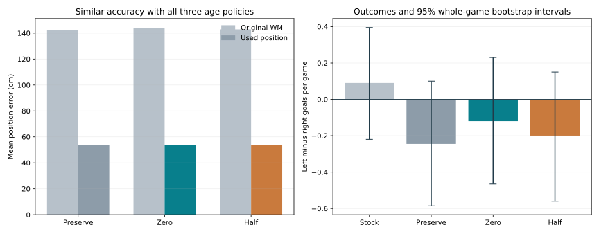
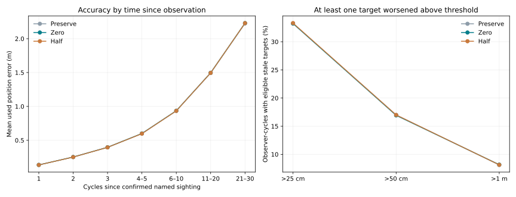

# Exp5: preserve, zero and half — 200 corrected-cache games each

**Half is correctly applied. All three policies reduce stale-player position
error substantially, but no gameplay advantage has been established.** Half
has balanced wins/losses and points; zero has the least negative goal difference.
There is no statistically established winner among the three policies.

Updated 2026-11-18 22:11 AST. All **600 games /13,200 finalized observers** identify cache-v2.
Left applies the same frozen model/selector; right is off. Views are adaptive,
visual quantization/hearing/fading are disabled, and fullstate is reference
only. Earlier 400 live games used the defective cache refresh and are excluded.

## 1. Game outcomes

| Batch | Goals L–R | W / D / L | Points L–R | Wins excluding draws | Goal diff/game |
| --- | ---: | ---: | ---: | ---: | ---: |
| Stock baseline (separate run) | 678–660 | 87/44/69 | 305–251 | 55.77% | +0.090 |
| Preserve | 635–684 | 78/22/100 | 256–322 | 43.82% | -0.245 |
| Zero | 678–702 | 78/35/87 | 269–296 | 47.27% | -0.120 |
| Half | 656–696 | 86/28/86 | 286–286 | 50.00% | -0.200 |


Half's 86 wins and 86 losses give 50% among decisive games, Wilson 95% interval
[42.61%, 57.39%]. The ordinary 43% win rate includes draws.
Points are balanced, but the goal difference is still −40; balanced wins do
not imply equal goal margins. These runs have different seeds and trajectories.

| Comparison | Change in goal difference/game | 95% independent-game bootstrap |
| --- | ---: | ---: |
| Half minus preserve | +0.045 | [-0.455, +0.520] |
| Half minus zero | -0.080 | [-0.580, +0.410] |
| Half minus baseline | -0.290 | [-0.760, +0.180] |


Every interval includes zero. Half improved observed points versus preserve
and zero, while its goal difference is worse than zero. Choosing the best
metric after seeing three runs is not evidence of a causal improvement.
The stock baseline is a separate historical run, not a matched-seed control.

The point difference below is **left points minus right points per game**,
not left points alone. Its independent whole-game bootstrap also includes zero:

| Comparison | Change in points difference/game | 95% bootstrap |
| --- | ---: | ---: |
| Half minus preserve | +0.330 | [-0.225, +0.885] |
| Half minus zero | +0.135 | [-0.405, +0.675] |




## 2. Paired position errors below 50 m

Scope: PlayOn, valid identified stale raw WM (original count >0), confirmed
named-sighting age 1–30, true observer distance <50 m and same-cycle truth.
Unselected rows retain WM and remain included. Fresh/unsupported tracks are
outside these means. Every eligible target-cycle has equal weight; game means
are not given equal weight. Counts: 125,021,864 preserve,
123,069,918 zero and 124,636,664 half.

| Metric | Preserve | Zero | Half |
| --- | ---: | ---: | ---: |
| Original WM mean cm | 142.32 | 144.00 | 142.87 |
| Used mean cm | 53.78 | 53.99 | 53.70 |
| Mean reduction % | 62.21 | 62.51 | 62.41 |
| Improved by >1 cm % | 54.58 | 55.21 | 54.89 |
| Added error >1 cm % | 5.51 | 5.53 | 5.56 |
| Added error >5 cm % | 5.19 | 5.22 | 5.24 |
| Added error >10 cm % | 4.79 | 4.81 | 4.83 |
| Added error >25 cm % | 3.77 | 3.79 | 3.80 |
| Added error >50 cm % | 1.71 | 1.71 | 1.72 |
| Added error >100 cm % | 0.77 | 0.78 | 0.77 |
| Maximum added error m | 14.28 | 14.95 | 14.68 |


Added error means used error minus original WM error for the same target and
cycle. All three reduced their paired mean in all 200 games. This scores raw
and corrected estimates along the actual treatment trajectory, not a game
that would have happened without correction. Different sample mixes explain
small accuracy differences; the weights/selection threshold did not change.

| Named-sighting age | Preserve original→used cm | Zero original→used cm | Half original→used cm |
| --- | ---: | ---: | ---: |
| 1 | 24.95→13.68 | 25.24→13.65 | 25.01→13.59 |
| 2 | 50.08→25.33 | 50.73→25.29 | 50.30→25.18 |
| 3 | 75.96→39.69 | 77.09→39.62 | 76.37→39.51 |
| 4–5 | 106.80→59.90 | 107.84→60.06 | 107.16→59.81 |
| 6–10 | 213.00→93.46 | 214.19→93.61 | 213.49→93.41 |
| 11–20 | 467.49→149.37 | 470.25→149.68 | 469.28→149.49 |
| 21–30 | 812.62→222.52 | 817.31→223.01 | 816.19→222.95 |




## 3. Mistakes that the scene average hides

Observer-cycle populations with at least one eligible stale target below 50 m:
10,069,393 preserve,
9,948,791 zero,
10,065,442 half.

| Eligible observer-cycle contains… | Preserve | Zero | Half |
| --- | ---: | ---: | ---: |
| At least one target improved >25 cm | 88.06% | 88.04% | 87.92% |
| At least one target worsened >25 cm | 33.25% | 33.23% | 33.32% |
| At least one target worsened >50 cm | 17.00% | 16.92% | 17.00% |
| At least one target worsened >1 m | 8.12% | 8.17% | 8.14% |
| Both improved and worsened >25 cm | 31.85% | 31.83% | 31.89% |
| Target within 10 m worsened >25 cm | 4.17% | 4.17% | 4.22% |


These are correlated exposures, not percentages of wrong actions or goals
caused. A frame can have many improved objects and one important damaged one.
Half's originally accurate WM subgroup (<10 cm) changed mean error
1.40→4.83 cm;
7.47% added >25 cm. Truth defines this diagnostic
group; it is not an available live selection rule.

- Largest added-error half case: game 202611181944_24952, observer
  l_3, cycle 3435, object 20:
  original 2.655 m→used 17.337 m,
  age 29, score 0.983.
- Accurate-WM failure from the context sample: game 202611181815_10548, observer
  l_11, cycle 361, original 0.044 m
  →used 5.642 m.

Both selected cycles reproduce in the original Python model pipeline.
The severity-weighted selector score is not calibrated positional confidence.

## 4. Near-ball and next-cycle checks

Each policy uses ten evenly spaced complete games /110 left observers,
selected without consulting outcomes. These are descriptive subsets, not full
200-game context audits. True distances are reporting labels only.

| Situation | Preserve original→used cm | Zero original→used cm | Half original→used cm |
| --- | ---: | ---: | ---: |
| Target within 2 m of ball | 46.94→33.18 | 45.17→31.32 | 46.52→32.96 |
| Target 2–5 m from ball | 51.62→34.12 | 49.86→32.19 | 50.13→33.34 |
| Target at least 5 m from ball | 146.19→54.35 | 145.49→54.40 | 147.95→54.22 |
| Observer within 3 m of ball | 204.64→68.68 | 214.67→69.65 | 204.46→68.27 |
| Next-cycle forecast; same valid WM velocity | 70.79→47.05 | 70.55→46.18 | 71.09→46.65 |


Ball-near stale-player gains are smaller than aggregate gains. The simple
next-cycle check uses the same valid WM velocity for both starting positions
and consecutive PlayOn truth; it is not a complete action/intercept simulation.
Neither ball state nor player velocity/body is corrected by this model.

## 5. Half implementation and runtime audit

- All 4,400 half records: 2,200 left apply/half and 2,200 right off/preserve,
  cache-v2, adaptive, correct frozen bundle and experiment parameters.
- Effective decision count is max(1,floor(raw trackedPosCount/2)) only while
  an accepted overlay is applied: 1→1, 2→1, 3→1, 4→2, 7→3. Raw/seen/heard
  ages and future model inputs remain unchanged. Preserve is still default.
- 80,783,415 overlays across all distances. Every count,
  eligibility, score and error-routing audit check returned zero violations;
  fresh states were not replaced and unselected counts were not modified.
- Four sampled observer checks (early, late and two failure cycles):
  86 outputs against PyTorch, no selection
  disagreements, maximum position difference
  0.00006592 m including CSV rounding.
  Routing joins checked 377,562 valid rows.
  Feature dumps were off, so this is sampled output parity, not a full native
  feature trace over all 200 games.
- No missing AutoTest console/order files, final-score mismatches or model/runtime
  errors. Command rounds: left first 686,118,
  right first 686,605. Inference per-game
  median range 13.89–
  15.57 ms; maximum
  58.48 ms. These are not whole action times.
- Current source and native regressions address the old duplicate-cache defect;
  batch CSVs do not directly trace all pointer-container sizes every frame.
  No new activation/count/routing defect was identified. This does not prove
  every planner interaction correct.

## 6. Conclusion

The three choices mostly alter how decision code treats an inferred position's
age. Half avoids a fake count-zero sighting while reducing some old-age margins;
it neither bounds the position error nor updates velocity/body/seen ages.
No count policy has demonstrated a gameplay advantage. Keep prediction opt-in;
retain it as a strong position estimator, not an established team-strength gain.
Further work should link mistakes to actual passes/intercepts/action changes
and use matched-seed, swapped-side controls before another model-size sweep.

## Reproduction

```bash
cd /home/nader/workspace/denoise
exp=rcssserver-denoise/experiments/exp5/exp5-s1
.venv-exp5-s1/bin/python "$exp/code/report_player_gap_three_counts.py" \
  logs/exp5-s1/live-analysis/preserve-cache-v2-200-20261118 \
  logs/exp5-s1/live-analysis/zero-cache-v2-200-20261118 \
  logs/exp5-s1/live-analysis/half-cache-v2-200-20261118 \
  "$exp/reports/live-count-cache-v2-200" \
  --closeout rcssserver-denoise/experiments/exp5/reports/final
```

The batch, context, scene-risk, runtime and Python-parity JSON evidence is
alongside this report. [Half launch details](../half-count-policy.md) ·
[Earlier preserve failure clips](../live-preserve-cache-v2-200/report.html).
