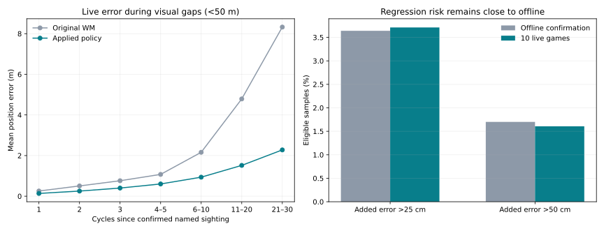

# Exp5-S1: first 10 live games, preserve-count policy

> **Later integration finding:** the earlier apply path duplicated derived
> player-cache entries and could repeat identity inference. The current cache-v2
> build fixes this. These historical match outcomes are not a clean gameplay
> evaluation of the intended prediction policy. See the
> [final report](../../../reports/final/report.html).

**Integration passes the pilot checks.** Left-only application is active and
position-error reduction is consistent with the frozen offline confirmation.
This is a snapshot of the first ten complete games, not a win-rate conclusion.

Generated 2026-11-16 23:30 UTC.
Source: `/home/nader/workspace/denoise/logs/exp5-live-preserve`.
Games still running at the snapshot were excluded. Both teams' 220 observer
logs finalized successfully. Every eligible target-cycle has equal weight.

## Main result: true observer distance below 50 metres

The denominator is **5,940,546 eligible stale target-cycles** observed by
the left team: identified valid stock track, positive original position count,
confirmed named-sighting age 1–30, PlayOn and valid same-cycle truth.
Unselected rows keep stock WM and remain in the denominator. Fresh/invalid
tracks and unsupported horizons are not included in these accuracy numbers.

| Metric | Frozen offline confirmation | First 10 live games |
|---|---:|---:|
| Original WM mean error | 134.98 cm | 142.59 cm |
| Selected-policy mean error | 52.30 cm | 52.97 cm |
| Reduction in mean error | — | 62.85% |
| Added error >25 cm vs WM | 3.64% | 3.71% |
| Added error >50 cm vs WM | 1.70% | 1.61% |
| Added error >100 cm vs WM | — | 0.75% |
| Largest added error | 11.82 m | 13.26 m |

Offline and live games have different trajectories, so matching means are
evidence of a consistent effect, not an exact replay. “Added error” is used
position error minus original WM error on the **same** observer-target-cycle.
The p95 absolute used error is 215.79cm. Below50m,
61.05% of eligible positions were replaced;
55.47% improved by >1cm and
5.40% worsened by >1cm; the rest were unchanged
or changed by at most 1cm.



## Error by time since confirmed named sighting

Named-sighting age is not always posCount: anonymous WM refreshes can lower
the latter without providing a confirmed named sighting. Every row below is
restricted to original posCount>0, so current count-zero refreshes are preserved.

| Named-sighting age | Original mean cm | Used mean cm | Reduction | Added error >25cm |
|---|---:|---:|---:|---:|
| 1 | 25.55 | 13.68 | 46.4% | 3.17% |
| 2 | 50.52 | 25.23 | 50.1% | 3.16% |
| 3 | 76.12 | 40.13 | 47.3% | 3.39% |
| 4–5 | 107.34 | 60.23 | 43.9% | 4.45% |
| 6–10 | 216.11 | 93.65 | 56.7% | 5.46% |
| 11–20 | 478.88 | 151.70 | 68.3% | 4.80% |
| 21–30 | 832.50 | 227.90 | 72.6% | 4.49% |

## Activation, routing and timing checks

- Left: 110 observers, all `apply`, `preserve`, `adaptive`, identical expected
  model bundle. Right: 110 observers, all `off`, `adaptive`, **zero corrections**.
- All 220 metadata records match the Exp5 preset: unquantized visual fields,
  finite view, no fading, no teammate payloads, synchronized execution and
  randomized command order. Fullstate is reference-only, never the decision WM.
- **3,879,643 positions applied** across all distances from
  6,720,682 eligible rows. No applied row was fresh, ineligible,
  outside age1–30, stopped, unselected or at/below the routing threshold.
- Original and effective counts matched on every checked prediction record.
  Every selected prediction was applied; used-error fields matched the chosen
  stock/prediction path. No runtime/model-loading/unknown-column errors found.
- Two full left-observer logs were joined with `objects`: used WM position,
  original position, application flag and effective count agree with prediction
  logs. One right observer was also checked: no overlay. No application outside
  PlayOn in these routing checks.
- Reconstructed the observation-only Python pipeline for two full-game left
  observers and compared 48 sampled eligible outputs:
  maximum position difference 0.00006497m,
  zero routing disagreements. Input diagnostic rows were not enabled in these
  live games, so this is an output replay check, not an exhaustive feature dump.
- 1,509,967 decisions logged, including
  1,094,434 PlayOn decisions across both teams;
  zero missing-decision placeholder rows.
- Live CPU inference: median 14.34ms,
  p95 23.79ms, maximum
  57.39ms. These exclude the rest of action time.
- Server command logs: 68,820 nonempty
  command rounds; left first 34,662, right
  first 34,158. Timing did not give either
  side a fixed first-command priority.

## Fresh measurement sanity and the worst regression

For sampled observers l6, l9 and r6, fresh localized named-player positions,
fresh ball positions and see-updated self positions have zero mean error at
the logger's displayed precision. This supports that visual quantization is
disabled. A **WM** count-zero track can still have association/fusion error;
count zero alone is not proof that a confirmed named visual measurement exists.

Worst below50m added-error case:
`202611161913_30182/l_7`, cycle 4857, target
right unum 10. Last named sighting was 30
cycles old; original posCount was 8. True observer distance
was 19.17m. Error increased from
**16.09m to 29.35m** despite a routing
score of 0.939. That score is not a calibrated probability of
correctness. This is a real rare regression, not removed from the averages.

## Match scores and next action

These same ten games finished **27–36 goals**, **3 wins /1 draw /6 losses** for
the treatment side. Improved position accuracy has not yet demonstrated better
gameplay. Ten games are too few to estimate the gameplay effect reliably.

Continue the planned preserve-count batch without changing the frozen model
or threshold mid-run. Then compare match results, positional error, tail risks
and tactical situations over the complete batch. Test zero-count separately
to distinguish the effect of position correction from age-based decision gates.

## Reproduce this snapshot

```bash
cd /home/nader/workspace/denoise
.venv-exp5-s1/bin/python \
  rcssserver-denoise/experiments/exp5/exp5-s1/code/summarize_player_gap_live.py \
  logs/exp5-live-preserve --complete-games-only --limit 10 \
  --output logs/exp5-live-preserve/pilot-under50.json
```

The reader now processes CSVs in chunks and retains only compact paired arrays,
so summary generation does not load all prediction columns into RAM. Its
results were regression-checked against the previous short-match summarizer.
The verifier now supports `--observer l_6 --observer l_9` and output replay
without feature diagnostics. JSON evidence is alongside this report:
under50.json, output-check.json, routing-check.json, runtime-check.json and
game-scores.json. The frozen game IDs are recorded in under50.json.
