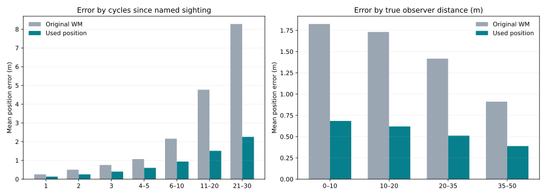
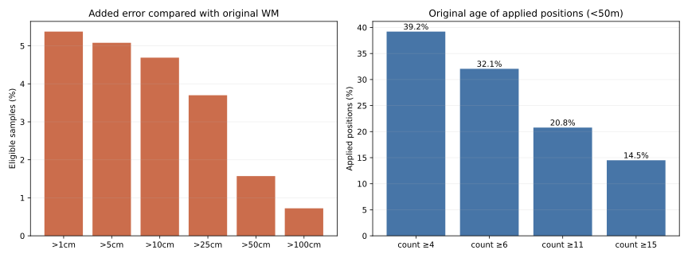
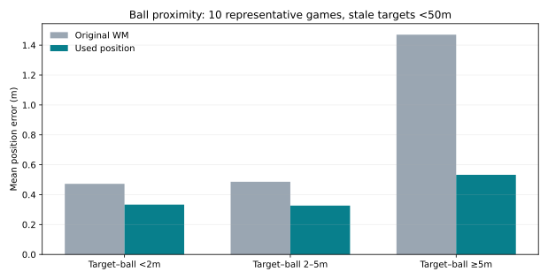

# Exp5-S1: 200 live games, position-count policy preserve

> **Later integration finding:** the earlier apply path duplicated derived
> player-cache entries and could repeat identity inference. The current cache-v2
> build fixes this. These historical match outcomes are not a clean gameplay
> evaluation of the intended prediction policy. See the
> [final report](../../../reports/final/report.html).

**Position accuracy improved, but the recorded game results worsened.** The
application is active and consistent with offline accuracy. This batch does
not establish that lower average position error makes the team stronger.

Generated 2026-11-17 02:16 UTC.
All 200 games and 4,400 observer logs finalized. Primary
accuracy uses true observer-target distance **below50m**, PlayOn, valid
identified stale tracks and confirmed named-sighting age1–30. Fullstate is
labels only. Every eligible target-cycle has equal weight; games are not
given equal weight for position averages.

## 1. Main results

| Metric | Result |
|---|---:|
| Left/right goals | 628 / 705 |
| Left wins / draws / losses | 75 / 30 / 95 |
| Paired stale target-cycles below50m | 116,211,295 |
| Original WM mean position error | 141.55cm |
| Used mean position error | **52.62cm** |
| Reduction in mean position error | 62.83% |
| Games with lower position-error mean | 200 / 200 |
| Improved by >1cm | 54.94% |
| Added error >1cm | 5.37% |
| Added error >25cm | 3.70% |
| Added error >50cm | 1.57% |
| Added error >1m | 0.72% |
| Maximum added error | 14.77m |

“Added error” means used error minus original WM error on the same target and
cycle; it is not absolute position error. Unselected rows retain WM and stay
in the denominator. Fresh and unsupported tracks are excluded from these paired
accuracy figures. Selected positions below50m: 70,284,076; applied positions
across all distances: 75,329,530. The frozen offline confirmation
was134.98→52.30cm, with3.64% adding >25cm and1.70% adding >50cm.



### By time since confirmed named sighting

| Group | Samples | Original mean cm | Used mean cm | Mean reduction | Added error >25cm |
|---|---:|---:|---:|---:|---:|
| 1 | 48,121,579 | 25.38 | 13.57 | 46.6% | 3.19% |
| 2 | 22,530,159 | 50.38 | 25.27 | 49.8% | 3.23% |
| 3 | 9,385,765 | 75.50 | 40.14 | 46.8% | 3.41% |
| 4–5 | 8,569,019 | 106.87 | 60.25 | 43.6% | 4.41% |
| 6–10 | 10,658,088 | 215.74 | 93.72 | 56.6% | 5.38% |
| 11–20 | 10,999,453 | 477.10 | 150.94 | 68.4% | 4.66% |
| 21–30 | 5,947,232 | 827.63 | 225.43 | 72.8% | 4.25% |

### By observer distance

| Group | Samples | Original mean cm | Used mean cm | Mean reduction | Added error >25cm |
|---|---:|---:|---:|---:|---:|
| 0–10 | 10,868,133 | 182.42 | 68.42 | 62.5% | 3.62% |
| 10–20 | 30,636,993 | 173.09 | 61.95 | 64.2% | 3.94% |
| 20–35 | 46,574,646 | 141.70 | 51.10 | 63.9% | 3.85% |
| 35–50 | 28,131,523 | 91.17 | 38.87 | 57.4% | 3.22% |

### Teammates and opponents

| Group | Samples | Original mean cm | Used mean cm | Mean reduction | Added error >25cm |
|---|---:|---:|---:|---:|---:|
| teammates | 56,559,461 | 139.46 | 51.98 | 62.7% | 3.69% |
| opponents | 59,651,834 | 143.54 | 53.22 | 62.9% | 3.71% |

## 2. Why preserve-count and better positions can still interact badly

About **14.50%** of applied positions below50m still had original
`posCount≥15`. The current librcsc player-intercept simulator returns1000 for
such a player before simulating it. Other paths also use position age to skip
players or expand their effective reach. Better coordinates do not remove
those gates when the age is preserved.

These counters measure exposure to code gates, not how often a particular
decision actually entered each branch. Observations alone do not prove these
branches caused the match losses.

| Original count condition | Applied positions below50m | Share of applied positions |
|---|---:|---:|
| ≥4 | 27,550,877 | 39.20% |
| ≥6 | 22,533,621 | 32.06% |
| ≥11 | 14,606,286 | 20.78% |
| ≥15 | 10,194,343 | 14.50% |

Code checked in the current checkout:

- `librcsc-denoise/rcsc/player/intercept_simulator_player.cpp`: the `posCount≥15`
  gate; prediction routing through decisionPos is present.
- `helios-base-denoise/src/player/planner/strict_check_pass_generator.cpp`:
  skips stale opponents above10 and uses age-based opponent reach bonuses.
- `planner/short_dribble_generator.cpp`: opponent bonus up to8 or4 cycles.
- `planner/field_analyzer.cpp`: virtual dash distance depends on the smaller
  of seenPosCount and posCount.

For the next batch use **`--player-gap-pos-count zero`** on the left only.
It makes effective posCount zero only on accepted overlays and preserves raw
tracking/visual ages. It therefore tests age-based decision behavior while
keeping the same model and threshold.

Zero does **not** remove every stale-data effect: the player-intercept bonus
still reads seenPosCount/heardPosCount, and velocity/body ages remain original.
An accurate current point also does not establish accurate future motion.
Zero may help or may make the agent too optimistic about bad predictions;
its performance has not yet been measured.



## 3. When WM was already accurate

For 24,280,560 eligible rows with original WM error below10cm,
the mean changed **1.43→4.84cm**.
7.80% of this subgroup added >25cm error.
The mean remains small, but rare severe regressions are hidden by that average.
These are truth-defined diagnostic groups, not deployable oracle gates.

| Group | Samples | Original mean cm | Used mean cm | Mean reduction | Added error >25cm |
|---|---:|---:|---:|---:|---:|
| 0–10cm | 24,280,560 | 1.43 | 4.84 | -238.0% | 7.80% |
| 10–25cm | 10,582,122 | 17.33 | 16.87 | 2.6% | 6.63% |
| 25–50cm | 31,799,328 | 39.83 | 22.11 | 44.5% | 1.75% |
| 50–100cm | 17,975,115 | 74.85 | 40.81 | 45.5% | 2.44% |
| 1–2m | 11,534,656 | 140.51 | 75.50 | 46.3% | 3.03% |
| 2m+ | 20,039,514 | 598.78 | 175.23 | 70.7% | 1.79% |

Worst overall below50m regression: `202611161920_12839/l_11`,
cycle1547, object21. Named age29,
original count29, observer distance46.50m.
Original error **3.04m**, used error
**17.82m**, added **14.77m**.
Its routing score0.976 is not a calibrated correctness probability.

The worst-error cycle and a separate already-accurate-WM failure were replayed
through the original PyTorch pipeline. Across36 eligible outputs in those
cycles, position differences stayed below0.000066m, including CSV rounding,
with zero routing disagreements. The severe model proposals reproduce in
Python; they are not explained by a different C++ calculation in these cases.

## 4. Important situations near the ball

This section uses **10 evenly spaced game IDs /110 left observers**, selected
without looking at game outcomes. These are descriptive sampled-game results,
not all200 games. Distances to the ball use truth for reporting only.



| Group | Samples | Original mean cm | Used mean cm | Mean reduction | Added error >25cm |
|---|---:|---:|---:|---:|---:|
| target_ball_under2m | 163,978 | 47.22 | 33.34 | 29.4% | 1.65% |
| target_ball_2to5m | 127,170 | 48.64 | 32.69 | 32.8% | 4.22% |
| target_ball_5mplus | 5,538,261 | 147.02 | 53.29 | 63.8% | 3.64% |
| observer_ball_under3m | 240,118 | 210.66 | 69.39 | 67.1% | 3.88% |
| observer_ball_3mplus | 5,589,291 | 139.12 | 51.54 | 63.0% | 3.59% |

The largest average gains are away from the ball. For stale targets within2m
of it, mean error changed **47.22→33.34cm**
(29.4% reduction), compared with
63.8% for targets at least5m from it.
Only2.81% of the eligible stale rows in this sample
were within2m of the ball. Fresh rows are excluded, so this percentage must
not be interpreted as the fraction of all players near the ball. Large gains
on many less immediate states do not translate directly into goals.

### One-step motion with unchanged velocity

For 4,235,177 rows with
valid current WM velocity and consecutive PlayOn truth, evaluate
`current_position + current_WM_velocity` against the true next-cycle position.
The same velocity is used for original and corrected positions. Mean one-step
error changed **69.01→
45.90cm**.
This simple forecast improved on that matched subset; it is not the complete
intercept/planner simulation and does not validate stale velocity/body estimates.

## 5. Integration and scheduling checks

- 4,400 finalized logs; all expected server parameters and
  reference-only fullstate settings matched. Left uses apply/preserve/adaptive;
  right is model-off/adaptive. All left logs use the same expected bundle.
- No fresh/ineligible/unselected/out-of-horizon or stopped rows were applied.
  All selected rows applied, effective counts matched policy, and used errors
  matched their recorded original/predicted path.
- 0 missing-decision placeholders
  in30,301,683 recorded decisions. This does not measure
  the full CPU action duration.
- Per-game inference medians were13.55–
  15.03ms; per-game p95s were
  22.85–25.21ms.
  Largest recorded inference was85.90ms.
  Per-game percentiles are kept separate; they were not averaged into a global p95.

- No model/runtime/unknown-column errors in the team console logs. All expected
  console and command-order files were found.
- 1,381,049 nonempty randomized command rounds: left first690,878
  (50.03%), right first690,171
  (49.97%). No fixed first-command advantage is visible.

## 6. Gameplay interpretation and next trial

The earlier all-stock Exp5 batch (200 games) had goals
678–660 and wins/draws/losses
87/44/69 for the left side. This batch has
628–705 and75/30/95.
The batch means of left-minus-right goals changed from+0.09 to−0.385 per game.
An independent-game bootstrap95% interval for that change was approximately
[-0.925,
-0.015] goals/game. This is an
unpaired, historical-batch comparison, not a matched-seed causal estimate.

Among decisive games in the current batch, the left win rate is
44.12%, Wilson95% interval
[36.87%,51.63%]. This differs from the ordinary75/200 win rate:
draws must be handled consistently when comparing with50%.

The recorded gameplay direction is worse and should be taken seriously.
Position-error reduction is not an adequate success criterion by itself.
The data identify retained age gates, occasional destruction of already-good
WM states, and smaller gains on immediate ball-near targets as concrete issues;
they do not isolate a single cause of the losses.

For the zero-count trial keep the model, threshold and server/view configuration
fixed. Use left-only `--player-gap-pos-count zero` and a separate
`logs/exp5-live-zero` directory. Compare gameplay, position accuracy, regression
tails and count-gate exposure with this preserve batch. A zero-count result is
still pending; no benefit is promised from that switch.

## Reproduce

```bash
cd /home/nader/workspace/denoise
exp=rcssserver-denoise/experiments/exp5/exp5-s1
.venv-exp5-s1/bin/python "$exp/code/audit_player_gap_batch.py" \
  logs/exp5-live-preserve logs/exp5-s1/live-analysis/preserve-200 --workers 6
.venv-exp5-s1/bin/python "$exp/code/audit_player_gap_context.py" \
  logs/exp5-live-preserve logs/exp5-s1/live-analysis/preserve-200/summary.json \
  logs/exp5-s1/live-analysis/preserve-200/context --workers 6
.venv-exp5-s1/bin/python "$exp/code/report_player_gap_live.py" \
  logs/exp5-s1/live-analysis/preserve-200 "$exp/reports/live-preserve-200"
```

Per-game summaries and detailed context observer caches are under logs/exp5-s1,
outside Git. Means and worsening rates aggregate exact sample counts and sums;
per-game p95 values are retained separately. Runtime/baseline bootstrap evidence
is in runtime.json. Severe-cycle PyTorch checks are in the two output-check
JSONs. Current runtime inference/model/weights were not changed by this audit.
