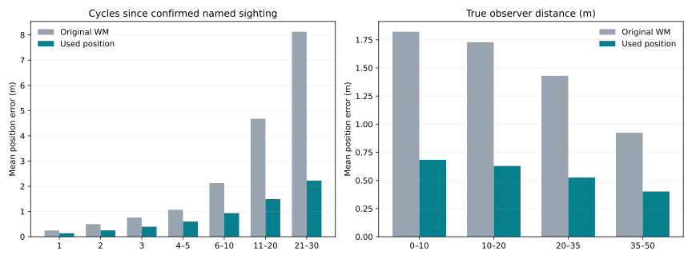
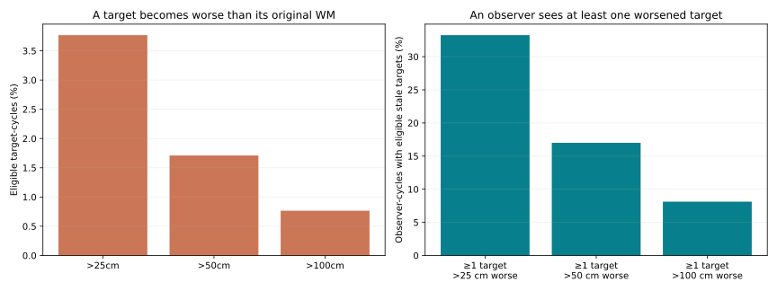
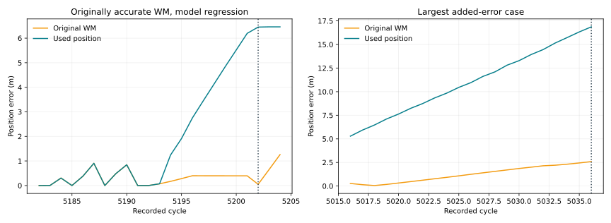

# Exp5: corrected cache-v2 preserve run, 200 games

**The visual improvement is real, but the model is not uniformly better and
the recorded team result is still worse than its opponent.** This fresh batch
uses cache-v2. Position accuracy improved in all 200 games; gameplay benefit has
not been established. The previous duplicate-cache defect is fixed in the
current code and this run's metadata identifies that revision throughout.

Generated 2026-11-18 19:19 UTC. Source is the replacement `logs/exp5-live-preserve` run,
with scores 635–684 and 78/22/100 W/D/L. Old live logs were removed; their archived
reports are historical evidence only. This analysis uses a new dated output
directory and validates source fingerprints, so old cached results cannot be
silently reused under the repeated log-directory name. The new zero run is
in progress and is not included in this report.

## 1. Actual position-error result

Primary denominator: **125,021,864** left-observer target-cycles in PlayOn,
true observer distance below 50 m, identified valid stale WM, original count >0,
named-sighting age 1–30 and same-cycle truth. Unselected rows retain WM and
remain in the denominator. Every sample has equal weight; game averages are
not averaged equally.

| Metric | Current cache-v2 preserve |
|---|---:|
| Original WM mean error | 142.32cm |
| Used mean error | **53.78cm** |
| Mean reduction | 62.21% |
| Games with lower mean than their own raw WM | 200/200 |
| Improved by >1cm | 54.58% |
| Added error >25cm | 3.77% |
| Added error >50cm | 1.71% |
| Added error >1m | 0.77% |
| Maximum added error | 14.28m |

Added error means used error minus raw WM error for the same observer/target/
cycle. The paired comparison scores both states on the actual treatment
trajectory; it is not a counterfactual game without the model. Fresh measurements
and unsupported/invalid tracks are not in these means.



Named-sighting age in cycles (first column):

| Group | Original mean cm | Used mean cm | Reduction | Added error >25cm |
|---|---:|---:|---:|---:|
| 1 | 24.95 | 13.68 | 45.2% | 3.17% |
| 2 | 50.08 | 25.33 | 49.4% | 3.29% |
| 3 | 75.96 | 39.69 | 47.7% | 3.51% |
| 4–5 | 106.80 | 59.90 | 43.9% | 4.43% |
| 6–10 | 213.00 | 93.46 | 56.1% | 5.49% |
| 11–20 | 467.49 | 149.37 | 68.0% | 4.76% |
| 21–30 | 812.62 | 222.52 | 72.6% | 4.34% |


## 2. Why the display can look excellent while mistakes remain

Per-target rates hide how often a multi-object scene contains at least one bad
estimate. Across **10,069,393** observer-cycles
with at least one eligible stale target below 50 m:

| Scene contains… | Observer-cycles |
|---|---:|
| At least one target improved by >25cm | 88.06% |
| At least one target worsened by >25cm | 33.25% |
| At least one target worsened by >50cm | 17.00% |
| At least one target worsened by >1m | 8.12% |
| Both an improvement >25cm and a regression >25cm | 31.85% |
| A target within 10 m of observer worsened by >25cm | 4.17% |



Both improved and worsened objects can be present in the same frame. These are
descriptive observer-target exposures, **not percentages of wrong decisions or
goals caused by the model**. They are correlated across objects, time and agents.
The model can visibly correct many positions and still put one tactically
important player on the wrong side of a pass/interception decision.

There were 221,353 observer-target
episodes with added error>1m; 100,211
lasted at least 3 consecutive cycles, maximum
28 cycles. These are not independent
real-world incidents; multiple observers can describe the same physical play.

## 3. Already-good WM and two real recorded examples

When the original WM error was below 10 cm, mean error changed
**1.43→4.79cm** across
25,464,403 eligible rows;7.37% added
>25cm. Large improvements on already-bad states dominate the global average,
while some already-good states are damaged. These truth-defined groups are
diagnostics, not directly available live gates.

| Group | Original mean cm | Used mean cm | Reduction | Added error >25cm |
|---|---:|---:|---:|---:|
| 0–10cm | 1.43 | 4.79 | -234.0% | 7.37% |
| 10–25cm | 17.45 | 17.80 | -2.0% | 7.50% |
| 25–50cm | 39.57 | 23.27 | 41.2% | 2.18% |
| 50–100cm | 74.82 | 41.56 | 44.5% | 2.50% |
| 1–2m | 140.06 | 72.85 | 48.0% | 2.74% |
| 2m+ | 588.89 | 173.67 | 70.5% | 1.82% |




- **Accurate WM damaged:** game 202611180055_20604, observer left 5, teammate 6,
  cycle 5202: error **0.050m→6.451m**; original count 11; routing score 0.962.
  The team actually won that game 5–3. This example proves a bad estimate, not
  that it caused a particular lost game or goal.
- **Largest added error:** game 202611180029_27747, observer l_5,
  opponent 9, cycle 5036: **2.591m→
  16.870m**; observer distance 18.82m,
  original count 29, score 0.985.

Both selected cycles were replayed with the original PyTorch pipeline:
41 eligible outputs, maximum difference
0.00005938m including CSV rounding,
zero selection disagreements. These failures reproduce in the learned model;
the checked cases are not explained by a different native computation.
The routing score is not a calibrated probability that a position is correct.

### Open these examples in SoccerWindow without rerunning games

The batch did not retain original RCGs at the checked output location. I exported
**reconstructed positioning clips** from the 22 agents' same-cycle truth columns,
plus the actual recorded raw/used positions as dlog. Both 41-frame clips pass
librcsc's native RCG parser. They are not original server RCGs: action counters
and unrecorded action-state bits are placeholders, so do not use them for action
analysis. No model was rerun to generate the drawn overlays.

1. Open [accurate-WM clip](replays/accurate-wm-damaged/reconstructed.rcg), load
   `replays/accurate-wm-damaged` as the **left** Debug Message directory, enable
   **WM**, select observer 5, and seek cycle 5202.
2. Open [largest-error clip](replays/largest-added-error/reconstructed.rcg), load
   `replays/largest-added-error` as left debug directory, select observer 5,
   seek cycle 5036.

Orange circle=raw WM; cyan square=used estimate; monitor players=reconstructed
truth. The clip README/provenance files record sources and limitations.

## 4. Immediately relevant situations near the ball

This section samples 10 evenly spaced complete games /110 left observers,
selected without looking at outcomes. It is not all 200 games. Distances to
the ball are labels for reporting, never model inputs from truth.

| Group | Original mean cm | Used mean cm | Reduction | Added error >25cm |
|---|---:|---:|---:|---:|
| Target within 2 m of ball | 46.94 | 33.18 | 29.3% | 1.55% |
| Target 2–5 m from ball | 51.62 | 34.12 | 33.9% | 4.42% |
| Target at least 5 m from ball | 146.19 | 54.35 | 62.8% | 3.67% |
| Observer within 3 m of ball | 204.64 | 68.68 | 66.4% | 3.92% |
| Next-cycle forecast, same valid WM velocity | 70.79 | 47.05 | 33.5% | 1.77% |


For stale targets within 2 m of the ball, the gain is
**46.94→33.18cm**, about
29.3%. At least 5 m from the ball it is
62.8%. The aggregate percentage gain therefore overstates the percentage improvement
for this ball-near subgroup; sample counts and tactical relevance differ. Fresh accurate positions
are preserved, so this is a statement about eligible stale rows, not all ball
contacts. The one-step forecast uses the same valid WM velocity for both points
and consecutive PlayOn truth; it is not a full planner simulation.

## 5. Current integration and scheduling checks

- All4,400 metadata records identify cache-v2. Left 2200 use apply/preserve,
  right 2200 use off; both adaptive, same frozen expected bundle for the left.
  No server-config/fullstate-reference violations were found.
- Current code clears all derived containers and lookup arrays and resets
  kickability before rebuilding; overlay refresh does not rerun identity
  inference. The earlier native duplicate-cache regression test passed.
- Batch CSVs do not contain every derived pointer-container size. Thus uniqueness
  is supported by the revision/source and native regression checks, not a direct
  per-cycle cache-size trace over these 200 debug-off games.
- 80,479,095 corrections applied across all distances; no fresh,
  unselected, ineligible, stopped or out-of-horizon rows were applied. All
  effective counts match preserve; raw/used error routing is consistent.
- In the two replayed full observer logs, 189,159
  valid rows were joined with objects; actual used positions/counts and raw
  positions/counts agree with the prediction records.
- No model/runtime errors, missing AutoTest console/order files, mismatched
  final scores or missing-decision placeholders were found in available logs.
- Random command order was balanced: left first
  685,982, right first
  685,913. Per-game inference median range
  14.48–15.82ms;
  largest inference 55.87ms. These are not full
  action times and no global percentile is inferred from per-game percentiles.

No new activation/routing defect was identified in this review. This is not a
proof that every possible planner interaction is correct; the visual scene and
point errors cannot alone validate tactical choices.

## 6. What preserve still means for decision code

14.46% of selected/applied positions below 50 m retain original count≥15.
The current player-intercept simulator skips such a player; pass/dribble/shot
paths also apply age gates or extra reach margins. These counts measure exposure
to gates, not how often a particular branch determined an action. Position is
corrected but velocity, body and seen ages are unchanged.

The in-progress new zero batch has cache-v2 /left apply-zero /right off metadata
in the checked sample. Its gameplay result is pending. It tests a different
decision-age policy, not a different network. No live model, library, threshold
or game configuration was changed during this review.

## 7. Gameplay conclusion and next action

Scores are **635–684**, wins/draws/losses **78/22/100**. Mean left-minus-right
goals are −0.245/game; whole-game bootstrap 95% interval
[-0.585,0.100].
Decisive-game win rate is 43.82%, Wilson 95% interval [36.74%,51.16%].
The ordinary 39% win rate includes draws and should not be compared directly
with 50% as though all games were decisive.

The observed result is worse and there is no established gameplay gain. The
intervals still include a balanced result; these data do not isolate a single
cause for the lost goals. Better point accuracy, nonzero tail risk, stale-motion
information and age-dependent action rules can coexist.

Finish the already-running cache-v2 zero batch with the same weights/threshold
and compare it with this dated run. Do not compare it with the removed legacy
zero batch as though both used this integration. There is no reason to repeat
this completed preserve batch again from the checks above. Improving scene
mean error further is not by itself a sufficient reason for more large trials.

## Reproduction and provenance

```bash
cd /home/nader/workspace/denoise
exp=rcssserver-denoise/experiments/exp5/exp5-s1
analysis=logs/exp5-s1/live-analysis/preserve-cache-v2-200-20261118
.venv-exp5-s1/bin/python "$exp/code/audit_player_gap_batch.py" \
  logs/exp5-live-preserve "$analysis" --workers 6
.venv-exp5-s1/bin/python "$exp/code/audit_player_gap_context.py" \
  logs/exp5-live-preserve "$analysis/summary.json" "$analysis/context" --workers 6
.venv-exp5-s1/bin/python "$exp/code/audit_player_gap_risk_cycles.py" \
  logs/exp5-live-preserve "$analysis/summary.json" "$analysis/risk-cycles" --workers 6
.venv-exp5-s1/bin/python "$exp/code/report_player_gap_cache_v2.py" \
  "$analysis" "$exp/reports/live-preserve-cache-v2-200"
```

The batch reader now checks metadata/data-file fingerprints before reusing a
cache and records integration revisions. Whole-game cached summaries stay in
the dated analysis directory. Historical reports remain unchanged as data
snapshots, separate from this new run. The numerical/model/RCG checks and JSON
evidence are alongside this report.
