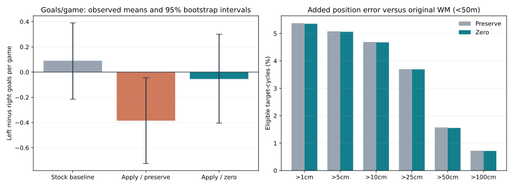
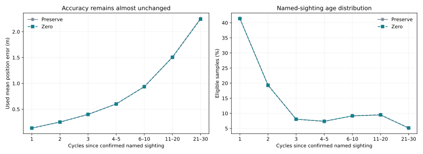
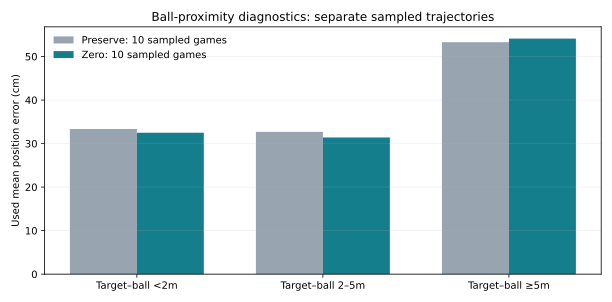

# Exp5-S1: zero-count live trial versus preserve

> **Later integration finding:** the earlier apply path duplicated derived
> player-cache entries and could repeat identity inference. The current cache-v2
> build fixes this. These historical match outcomes are not a clean gameplay
> evaluation of the intended prediction policy. See the
> [final report](../../../reports/final/report.html).

**The zero-count setting works. The observed match result is better than the
preserve batch, but the team has not demonstrated a gameplay advantage over
stock. Position accuracy is almost identical in the two model batches.**

Generated 2026-11-17 19:37 UTC. Current logs: `/home/nader/workspace/denoise/logs/exp5-live-zero`.
Both model batches have200 complete games /4,400 finalized observers. Left
uses the same frozen model; right is off. Only effective position-count policy
changes from preserve to zero; both teams retain adaptive views. Game seeds
are different, so comparisons are unpaired and trajectories are not identical.

## 1. Game outcomes

| Batch | Goals L–R | W / D / L | Points L–R | Win rate excluding draws |
|---|---:|---:|---:|---:|
| Stock baseline | 678–660 | 87/44/69 | 305–251 | 55.77% |
| Apply / preserve | 628–705 | 75/30/95 | 255–315 | 44.12% |
| Apply / zero | 704–715 | 85/30/85 | 285–285 | 50.00% |


The decisive-game rate excludes draws (zero:85/(85+85)=50%). Its Wilson95%
interval is[42.57%,
57.43%]. The ordinary win rate,
including draws in the denominator, is85/200=42.5%; it must not be compared
directly with50% as though every game were decisive.

Left-minus-right goals/game changed **−0.385 →−0.055** from preserve to zero,
an observed +0.330. Independent whole-game bootstrap95% interval for that
change: **[-0.165,+0.815]**. It includes zero, so these200-game
batches do not establish that the improvement was caused by the count switch.
There are no shared simulator/order-seed pairs between the two runs.

Compared with the historical all-stock Exp5 batch, the zero-count change in
goal difference is-0.145/game,
95% bootstrap interval[-0.615,+0.325]. This also includes zero.
The historical stock batch is a separate run, not a matched-seed control.



## 2. Position accuracy and mistakes below50 metres

Each eligible target-cycle has equal weight. The denominator requires a
valid identified stale WM position, original posCount>0, named-sighting age1–30,
PlayOn and same-cycle truth. Unselected rows retain WM and remain included.
Fresh/invalid/unsupported tracks are not included in these accuracy means.

| Metric | Preserve | Zero |
|---|---:|---:|
| Paired eligible samples | 116,211,295 | 115,986,537 |
| Original WM mean error | 141.55cm | 143.05cm |
| Used mean error | **52.62cm** | **52.58cm** |
| Mean-error reduction | 62.83% | 63.24% |
| Improved by >1cm | 54.94% | 55.33% |
| Added error >1cm | 5.37% | 5.35% |
| Added error >5cm | 5.08% | 5.06% |
| Added error >10cm | 4.69% | 4.68% |
| Added error >25cm | 3.70% | 3.69% |
| Added error >50cm | 1.57% | 1.55% |
| Added error >1m | 0.72% | 0.72% |
| Largest added error | 14.77m | 14.04m |
| Games with a lower position-error mean than their own WM | 200/200 | 200/200 |

Added error is used position error minus original WM error for the same
observer/target/cycle, not absolute error. The two batches have different
sample mixes. The difference between52.62cm and52.58cm is not evidence of a
better network: the weights and selection threshold did not change.



### By named-sighting age

| Age | Preserve mean cm | Zero mean cm | Preserve adds >25cm | Zero adds >25cm |
|---|---:|---:|---:|---:|
| 1 | 13.57 | 13.46 | 3.19% | 3.22% |
| 2 | 25.27 | 25.11 | 3.23% | 3.24% |
| 3 | 40.14 | 39.91 | 3.41% | 3.38% |
| 4–5 | 60.25 | 60.16 | 4.41% | 4.38% |
| 6–10 | 93.72 | 93.57 | 5.38% | 5.32% |
| 11–20 | 150.94 | 150.39 | 4.66% | 4.56% |
| 21–30 | 225.43 | 224.31 | 4.25% | 4.15% |

### By true observer-target distance

| Distance m | Preserve original→used cm | Zero original→used cm | Preserve adds >25cm | Zero adds >25cm |
|---|---:|---:|---:|---:|
| 0–10 | 182.42→68.42 | 183.76→68.20 | 3.62% | 3.59% |
| 10–20 | 173.09→61.95 | 174.75→61.95 | 3.94% | 3.92% |
| 20–35 | 141.70→51.10 | 143.40→51.00 | 3.85% | 3.84% |
| 35–50 | 91.17→38.87 | 91.82→38.84 | 3.22% | 3.22% |

## 3. Was posCount really zero, and did it contaminate the next input?

- All2,200 left metadata records use apply/zero/adaptive and the expected
  bundle. All2,200 right records use model-off/adaptive.
- **75,602,272 predictions applied** across all distances. Every
  applied prediction record has decision_count=0, while stock_count stays
  positive. No applied row was fresh, ineligible, unselected, stopped, outside
  age1–30, or at/below routing threshold0.8.
- Effective count of an unselected eligible position remains its original
  count. Zero does not rewrite raw tracker/seen ages or velocity/body state.
- Raw object joins were checked in two full left-observer logs and one right
  observer: 167,861 valid target rows,
  including 68,020 applied rows.
  Exposed WM position/count and prediction-log position/count agree; the
  raw stock fields retain their original values. Right has no overlay.
- Reconstructed the observation-only Python pipeline from the same logs:
  48 sampled eligible outputs from the
  first and last game, zero routing disagreements; maximum position difference
  0.00006554m including CSV rounding.
  Input feature dumps were off, so this is a sampled output replay check.
- No server-configuration violations, model/runtime/unknown-column errors,
  missing console/order files or disagreement between metadata and final
  AutoTest score lines were found.
- No missing-decision placeholder rows in 30,430,945
  recorded decisions. Per-game inference medians were
  12.55–14.30ms;
  per-game p95 range21.23–
  23.11ms; maximum
  82.74ms. These are inference times only.
- 1,386,937 nonempty randomized command
  rounds: left first692,998, right first
  693,939. No fixed side priority is visible.

The zero setting removes posCount-based skips/margins while a forecast is
accepted. It does not remove all age handling: some intercept bonuses and
receiver/look checks use seenPosCount/heardPosCount; velocity/body ages are
unchanged. The original age distribution remains similar in both batches.

## 4. Near-ball and next-cycle checks (10 sampled games per policy)

Each context sample uses110 left observers from10 evenly spaced game IDs,
chosen without using outcomes. These are separate sampled trajectories and
must not be presented as the full200-game context result. True distances are
labels for reporting only; none enters inference.



| Situation | Preserve original→used cm | Zero original→used cm | Preserve adds >25cm | Zero adds >25cm |
|---|---:|---:|---:|---:|
| Target within2m of ball | 47.22→33.34 | 47.17→32.48 | 1.65% | 1.50% |
| Target2–5m from ball | 48.64→32.69 | 50.05→31.40 | 4.22% | 4.76% |
| Target at least5m from ball | 147.02→53.29 | 150.91→54.11 | 3.64% | 3.76% |
| Observer within3m of ball | 210.66→69.39 | 225.14→70.09 | 3.88% | 4.05% |
| Next cycle: current position + unchanged valid WM velocity | 69.01→45.90 | 69.26→45.54 | 1.69% | 1.75% |

For zero, target-near-ball error is47.17→
32.48cm (31.1% reduction). This is a
smaller gain than on the overall stale sample. The one-step test uses identical
valid WM velocity for both candidate positions and true consecutive PlayOn
positions; it is not the complete planner/intercept simulation.

## 5. Remaining regression risk

On 24,042,671 zero-batch eligible samples where WM error was already
below10cm, mean error changed **1.38→4.85cm**;
7.90% added >25cm. These are truth-defined
diagnostic groups, not a deployable oracle rule.

Worst added-error case below50m: `202611170135_23762/l_2`,
cycle227, object21; named age29,
original count29, effective count0. Observer distance
23.67m; error changed **2.89→
16.93m**, adding14.04m. Routing score
0.973 is not a calibrated correctness probability.

Zero lets decision code use corrected stale players more freely, but also
presents bad accepted forecasts as effective count-zero states. It does not
make their uncertainty equal to a real fresh named measurement.

## 6. What this run establishes, and the next useful diagnostic

1. The selected model still reduces mean current-position error substantially.
   Integration checks and sampled Python replay agree in zero mode.
2. Keeping age and zeroing age produce almost identical position-error metrics.
   Their distinction is decision behavior. The observed zero batch is better
   than preserve, but the unpaired result is not statistically conclusive.
3. Neither live trial has established stronger gameplay than stock. Even
   zero's balanced85/30/85 does not demonstrate a gain over the original team.
4. Current-point mean error is insufficient as the sole success metric. Rare
   wrong corrections, remaining motion uncertainty, and action-dependent costs
   still matter. Existing logs do not isolate a single cause of lost goals.

Do not treat zero as a confirmed winning policy or enlarge the network based
on these results alone. If continuing research, a useful next diagnostic is
a clearly labelled **oracle-position ceiling test**: on the same eligible/
selected stale players, provide same-cycle true position for testing only,
with stock velocity/body and an explicit count policy. Keep it separate from
training/normal model inference, use controlled seeds and swap treatment sides.
This would help distinguish residual position-estimation failures from limits
of current-point-only information and the planner's use of it. It is a proposed
experiment; no oracle inference or new runtime behavior was implemented here.

## Reproduce

```bash
cd /home/nader/workspace/denoise
exp=rcssserver-denoise/experiments/exp5/exp5-s1
.venv-exp5-s1/bin/python "$exp/code/audit_player_gap_batch.py" \
  logs/exp5-live-zero logs/exp5-s1/live-analysis/zero-200 --workers 6
.venv-exp5-s1/bin/python "$exp/code/audit_player_gap_context.py" \
  logs/exp5-live-zero logs/exp5-s1/live-analysis/zero-200/summary.json \
  logs/exp5-s1/live-analysis/zero-200/context --workers 6
.venv-exp5-s1/bin/python "$exp/code/audit_player_gap_runtime.py" \
  logs/exp5-live-zero AutoTest2D/out/exp5-live-zero \
  logs/exp5-s1/live-analysis/zero-200/runtime.json \
  --reference preserve logs/exp5-live-preserve --reference baseline logs/exp5-logs
.venv-exp5-s1/bin/python "$exp/code/compare_player_gap_live.py" \
  logs/exp5-s1/live-analysis/preserve-200 logs/exp5-s1/live-analysis/zero-200 \
  "$exp/reports/live-zero-200"
```

Per-game/observer caches are under logs/exp5-s1 outside Git. JSON evidence is
alongside this report. Means and worsening rates are weighted by exact sample
counts; per-game percentiles are not averaged into a global percentile.
Game-outcome bootstrap uses whole games. No model weights, server, librcsc or
Helios runtime code was changed by this review.
