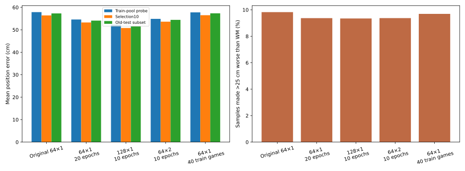
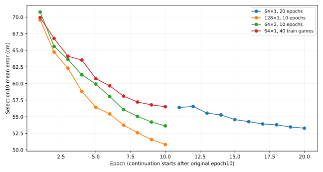

# Exp5-S1 capacity, depth, training and data-diversity study

**Exploratory reuse of previously inspected test games; one seed.** All model settings were fixed before this study’s test scoring. Checkpoints were selected only on the original ten selection games.

The original training curve was still improving at epoch10 (selection mean70.82→56.41 cm). That motivates an actual comparison rather than assuming more capacity/data will help.

| Variant | Parameters | Train-pool probe cm | Selection cm | Old-test subset cm | p95 cm | Worse >0 cm % | Worse >25 cm % | Max added error m |
|---|---:|---:|---:|---:|---:|---:|---:|---:|
| Original 64×1 | 32,882 | 57.88 | 56.41 | 57.30 | 250.27 | 32.80 | 9.83 | 12.43 |
| 64×1, 20 epochs | 32,882 | 54.59 | 53.27 | 54.10 | 230.95 | 32.42 | 9.37 | 13.24 |
| 128×1, 10 epochs | 123,058 | 52.30 | 50.82 | 51.56 | 218.12 | 32.14 | 9.35 | 12.74 |
| 64×2, 10 epochs | 57,842 | 54.88 | 53.62 | 54.43 | 237.28 | 32.52 | 9.37 | 13.12 |
| 64×1, 40 train games | 32,882 | 57.78 | 56.51 | 57.34 | 251.26 | 32.87 | 9.70 | 12.60 |

Checkpoint-selection winner: **128×1, 10 epochs**, chosen from selection error, not test error. Test subset contains 500,000 identical, uniformly sampled eligible target-cycles for every variant. Main scores are sample-weighted.

## Controlled questions

- **More training:** continue the saved64-unit weights for ten additional epochs at lower learning rate3e-4→5e-5. AdamW is restarted because the original optimizer state was not saved. Total sampled endpoints become4.096M.
- **More width:**128 hidden units, one GRU layer; fresh ten-epoch training with the same2.048M endpoint budget and endpoint RNG sequence as the original160-game model.
- **More depth:**64 hidden units and two GRU layers; same fresh-training budget. No extra dropout is introduced, so this isolates layer/capacity changes under the fixed recipe.
- **More source-game diversity:**40 versus160 training games at the same2.048M endpoint budget. The40 games are a fixed seeded subset of the original160, with all their observers; this is not a comparison of40 versus160 fully enumerated datasets.

## Interpretation and limits

Compare the train/selection errors and curves together. Falling train and selection error supports remaining optimization/capacity headroom. A wider/deeper model is not automatically better, and lower average error does not imply fewer harmful replacements of already-accurate WM.

The50k train-pool probe is shared across all variants and drawn from the original160 training games. For the40-game model it therefore includes games outside its fit subset: call that column a common training-pool diagnostic, not its in-sample training error. The160-game variants provide the clean train-versus-selection comparison.

More raw games, more sampled endpoints and more optimizer updates are different interventions. Only a small part of the227M eligible training endpoints was sampled in the original run. If extra data are collected, target distinct difficult situations rather than merely duplicating common trajectories; choose sampling/weights on training and validation, then retain natural sample weights at evaluation.

This study does not establish new-team generalization or live-game benefit. The old20 test games have already been inspected in earlier analyses, so these results are exploratory; confirm any chosen recipe on a fresh independent batch before deployment. All raw metrics, exact40-game subset, indices and configs are stored beside results.json.
