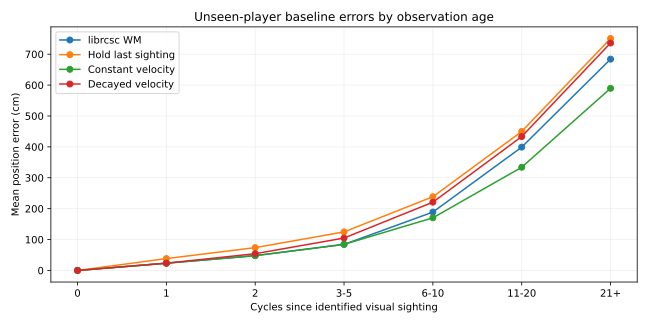

# Exp5 step 01 · Quantization-free finite-view baseline

2026-11-15 · Infrastructure and pilot only; the 100-game collection is pending.

## Ready

The current denoise branches retain their baseline logger. No Exp3/Exp4
models were imported. Server/librcsc/Helios were rebuilt, librcsc installed
under /home/nader/local, and the server installed at /usr/local/bin/rcssserver.
Helios's normal build/bin contains the new baseline executable and scripts.

A new opt-in server::see_no_quantization flag sends exact visual distances,
bearings, radial/angular changes, body/head directions and line geometry
for v19 clients. It also sends precise sense-body speed/direction/neck
kinematics and higher-precision fullstate reference. It does not change
visibility cones, visual cadence or action/physics equations.

Client localization bypasses quantization intervals in this mode, uses an
observed landmark plus observed face for the visual self-position fix,
and reconstructs unquantized observed motion. No fullstate values enter
these estimates. Default mode and the existing distance-only
see_noise_free behavior remain separate.

## Verification

| Test | Result |
|---|---|
| Fixed narrow, 60° | 22 finalized agents; 100% of scored decisions use narrow; see each cycle |
| Fixed normal, 120° | 22 finalized agents; 100% normal; see fraction 49.6% |
| Fixed wide, 180° | 22 finalized agents; 100% wide; see fraction 33.2% |
| Adaptive, 600 scheduled cycles | 22 finalized agents; all three widths; see fraction 63.9% |
| Installed-server adaptive probe | 22 finalized agents; exact-mode checks passed |
| Quantized negative control | Original integer-bearing/quantized error remains |
| Baseline regression tests | Causal history, no future-sighting leakage, setplay reset, missing velocity and decay formula passed |

Fixed-policy checks exclude the first ten game cycles. The counts use
PlayOn decisions, not stopped time. For all exact pilots, maximum logged
raw distance, bearing, motion and relative-body errors and fresh localized
player position error are **zero at the logger's 1e-6 resolution**.
The quantized control has nonzero errors, including maximum range error
4.77 m and bearing error 0.50°; exact mode is therefore not a labeling-only
change.

Ordinary physical randomness is retained. Self prediction between visual
updates can still accumulate error. Zero visual quantization does not make
unseen future actions deterministic. Pointing gestures and unrelated
administrative fields retain their ordinary format; this study does not
use them as exact kinematic measurements.

[Full configuration and verification evidence](pilot/verification.json)

## Where we start

The final adaptive pilot contains 9,592 PlayOn decisions from 22 observers.
There are 176,901 paired player target-cycles, including 123,700 cycles
without a current sighting. Each paired target-cycle receives one weight.

| Age since last identified sighting | librcsc WM | Hold position | Constant velocity | Decayed velocity |
|---|---:|---:|---:|---:|
| 0 | 0.00 | 0.00 | 0.00 | 0.00 |
| 1 | 23.52 | 38.45 | 23.52 | 23.52 |
| 2 | 47.95 | 73.88 | 47.96 | 54.23 |
| 3-5 | 84.34 | 124.89 | 84.57 | 104.96 |
| 6-10 | 188.92 | 238.63 | 170.39 | 220.98 |
| 11-20 | 399.22 | 449.78 | 334.05 | 433.34 |
| 21+ | 683.96 | 750.85 | 589.56 | 736.13 |

Values are mean position distance error in cm. The approximately 0.004 cm
fresh-row mean comes from comparing the logger's four-decimal WM
coordinates with six-decimal truth, not visual quantization.

Constant velocity is close to stock at short gaps and lower-error in the
long-gap groups of this pilot. That is a hypothesis to measure across the
100 games, not a selected new live policy. Decay alone and holding a fixed
position were weaker here.

Baselines use only the last unambiguous identified visual localization and
the velocity available at that sighting. Missing velocity uses zero.
The decay baseline uses the server default, not a fullstate player type.
Truth supplies evaluation labels and distance subgroups only. Histories
reset across interrupted PlayOn blocks; future sightings are never used.

Anonymous close sightings do not refresh labeled baseline history and are
omitted from scored gap rows. The pilot omitted 743 such rows. WM positions
were missing on 16,599 of 194,243 rows with a prior identified sighting;
these are excluded from paired means and counted explicitly. Do not infer
all-player coverage from the paired error alone.

The raw logs also preserve actual sightings, identities/matching flags,
WM age counters, view widths, commands, self state, truth and available
velocity/body information, so later datasets can revisit those exclusions.

[Paired metrics, coverage, distance/view subgroups and frozen game](pilot/metrics.json)

## Next step

Collect 100 baseline games with both teams using adaptive view and the same
sensor settings. Then score the completed logs with analyze.py, inspect
gap-age/distance cohorts and lost-track coverage, and choose a prediction
target against the strongest causal baseline. A future learned model must
retain exact visible measurements and predict only missing state; it must
not reuse the old requirement for eight consecutive sightings.
