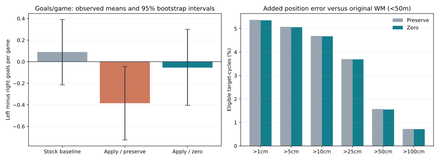

# Exp5 final report: predicting players during visual gaps

**Research collection is complete.** The frozen model substantially reduced
current-position error. The two live trials recorded worse/neutral game results,
but a significant integration defect was discovered while adding the visual
debugger. Those match results cannot cleanly establish the gameplay effect of
the intended prediction policy. The current build fixes that defect and adds
an opt-in inspector for every observer. The original closeout below records the
short integration tests. A new corrected-cache batch was reviewed on 2026-11-18.

## Latest corrected-cache comparison · 2026-11-18

[Full comparison](../../exp5-s1/reports/live-count-cache-v2-200/report.html) · [Half-count launch and checks](../../exp5-s1/reports/half-count-policy.md).

Zero completed **678–702 goals, 78/35/87 W/D/L**, versus **635–684, 78/22/100**
for preserve. Both have 200 games /4,400 finalized cache-v2 observers. Below
50 m, eligible stale-target error means are **53.99 /53.78 cm**, respectively;
added error >25 cm remains in **3.79% /3.77%** of target-cycles. Zero was correctly
applied; no gameplay gain over stock is established. Its observed +0.125 goals
difference/game versus preserve has independent-game bootstrap 95% interval
[-0.365,+0.610], including zero. Seeds/trajectories are different.

The requested **half** policy is now available: max(1,floor(original raw
posCount/2)), on applied overlays only. Preserve remains default. Native/live
correctness checks exist; no half gameplay benchmark has completed.

## Follow-up · 2026-11-18 · corrected-cache preserve, 200 games

[New report, plots and SoccerWindow replays](../../exp5-s1/reports/live-preserve-cache-v2-200/report.html).
All 4,400 observer metadata records identify cache-v2. Scores **635–684**,
**78/22/100 W/D/L**. Eligible stale-target position error below 50 m changed
**142.32→53.78 cm (62.21% reduction)**; added error >25 cm remained in 3.77%
of target-cycles. At least one such regression was present in 33.25% of
observer-cycles with eligible targets, including frames with simultaneous gains.
This is a genuine point-accuracy improvement, not an established gameplay gain.
The new zero run is included in the latest comparison above. The old live reports remain pre-fix historical data.

## Essential qualification: the earlier live integration was defective

> Both200-game live batches used a cache-refresh path that appended duplicate
> player references and could rerun identity inference after a correction.
> Fixing this changes decision behavior. Do not use the old400 games to conclude
> that accurately predicting unseen players cannot improve the team.

The earlier audits correctly measured position errors, count-policy flags,
logged applications and scores. Their sampled output replay checks also passed.
They did not check uniqueness of the derived decision player containers.
That missing structural check matters: a correct point can coexist with a bad
planner world representation.

## What was isolated and trained

- Baseline:200 games, all4,400 observer logs; unquantized visual fields, adaptive
  60°/120°/180° views, no teammate payloads and far-field fading disabled.
  Visible measurements are exact at the recorded precision; aging, identity
  association and unobserved actions still cause WM error.
- Position-only study: deterministic, uncertainty and mixture predictors,
  followed by model/feature/selector refinements. Training and evaluation split
  by whole game. Future truth never enters inference.
- Final frozen practical policy: GRU128,51 observation-only features, a
  categorical uniform-number embedding,32-cycle rolling windows and a boosted
  selector with strict score>0.8. Predict current x,y for identified stale
  tracks, named-sighting age1–30 in continuous PlayOn.
- Preserve fresh raw count-zero updates. Output is current player position;
  velocity/body, ball and self are not learned outputs in Exp5-S1.
- Model loading and inference live in Helios. Librcsc supplies an observation-only
  callback and a temporary decision-position overlay. Fullstate is labels only.

## What the data showed

| Evaluation | Original WM mean cm | Used mean cm | Added error >25cm | Added error >50cm |
|---|---:|---:|---:|---:|
| Independent offline confirmation, practical policy | 134.98 | 52.30 | 3.64% | 1.70% |
| Live preserve, historical integration | 141.55 | 52.62 | 3.70% | 1.57% |
| Live zero, historical integration | 143.05 | 52.58 | 3.69% | 1.55% |

These figures use eligible stale target-cycles below50m, giving each sample
equal weight. Unselected rows retain WM. Live paired errors compare the raw and
used states on the actual treatment trajectory; they are not the counterfactual
trajectory of a game without the model.

The means improved in all200 games of each live batch. Rare severe regressions
remained: maximum added error14.77m /14.04m for preserve/zero. The selector score
is not a calibrated correctness probability. In the zero batch, when original
WM error was already below10cm, mean error changed1.38→4.85cm;7.90% of that
subgroup added >25cm. These truth-defined groups diagnose risk, not deployable
oracle gates.

## Recorded match outcomes — retain as historical results

| Batch,200 games each | Goals left–right | Left W/D/L |
|---|---:|---:|
| All-stock baseline | 678–660 | 87/44/69 |
| Apply / preserve, old integration | 628–705 | 75/30/95 |
| Apply / zero, old integration | 704–715 | 85/30/85 |

Zero recorded better outcomes than preserve, but its unpaired bootstrap95%
interval for the goal-difference change included zero. Different seeds and the
integration defect prevent a clean causal interpretation. The zero setting
does not establish stronger gameplay than stock, and these data also do not
establish that a correct integration would fail.

Near-ball diagnostics on10 sampled games per policy showed smaller gains than
the global average. For targets within2m of the ball:47.22→33.34cm with preserve,
47.17→32.48cm with zero. A simple one-step forecast using unchanged valid WM
velocity also improved on its matched subset. These descriptive measurements
do not prove why particular passes or games failed.

## The integration defect and correction

Applying and clearing an overlay called `updatePlayerStateCache` again. That
routine originally assumed one call per cycle: it appended to derived player
lists, used those list sizes during identity/goalie inference and retained
kickable pointers when no new candidate was found. Reusing it as a refresh
therefore had three problems:

1. Duplicate player references entered sorted, all-player and team containers.
   Algorithms counting players or iterating candidates received a different
   state representation. A debug run reproduced up to42 entries for the21
   other known players;3,113 of4,400 left-observer frames contained duplicates.
   The shadow right team had no duplicate frames in the same run.
2. Identity inference could run again after a correction and see different
   geometry/list sizes. A feature replay check exposed a target whose logged
   identity/stock state differed from the earlier inference snapshot.
3. Refreshing kickability did not first reset the current cached pointers,
   allowing an earlier candidate to survive a changed position.

The corrected routine clears all derived containers, lookup arrays and current
kickable pointers before rebuilding. Identity inference runs on the normal raw
update; overlay application/clearing uses a geometry-only rebuild. The raw
tracker positions, ages and visual history remain separate from forecasts.
Weights, architecture, threshold and sensor configuration were not changed.

New metadata records `player_gap_integration=cache-v2`. The visual banner also
shows cache-v2, container counts and a uniqueness check. Old live logs lack this
revision marker. Model default remains off.

## Validation after correction

- Corrected short all-target match:22 finalized observers;7,260 debug packets,
  maximum4,717 bytes;96,377 original/used geometry pairs matched CSV positions;
  15,216 accepted corrections. No clipped debug packets. Debug cache checks
  cover all seven derived containers, not just a single drawing list.
- The earlier corrected-cache run had zero duplicate player frames on both
  teams (4,730 frames/side), maximum21 other known players.
- Full51-feature replay on the all-target test:104,874 rows, maximum normalized
  feature difference2.45e-6. Raw/used routing and zero-count checks passed.
- Focused-target preserve test with model-off right team:22 finalized observers,
  valid colored packets and no clipping. Full feature/routing replay also passed.
- Final packaged build: an additional22-observer check passed and all metadata
  records identify cache-v2.
- A synthetic overloaded UDP packet test emitted a valid7,787-byte packet
  below the viewer limit, retained balanced syntax, sent circle colors correctly
  and cleared old planner drawings/targets. The packet cap is opt-in.
- CMake Release librcsc was built/installed and Helios rebuilt; both build-system
  source lists were updated. Full autotools build was not run.

Short tests verify integration and visualization, not win-rate improvement.
At the original debugger handoff, no full corrected-cache batch had been run.
The dated follow-up above now records the new 200-game preserve benchmark.
No SoccerWindow GUI interaction was automated; protocol geometry and saved logs
were checked against the viewer format/source and decision CSVs.

## Visual handoff

[Complete one-game commands, colors and log-directory instructions](../../debug/README.md).

- Orange circle: original raw WM track position.
- Cyan square: actually used decision position.
- Cyan connecting line: the correction displacement, not velocity.
- Fixed marker size is a visual symbol, not error radius or kickable area.
- Each of the11 observers writes its own view. Choose the observer in
  SoccerWindow; optionally focus on one teammate/opponent through a launch flag.
- Rejected/shadow-only proposals appear in text, not as an extra applied marker.
  No additional truth marker is drawn; real players belong to the monitor view.

The display supports live DebugClient packets and colored dlog files. It is
off by default and does not read fullstate or feed data back into inference.

## Handoff and conclusion

Exp5 demonstrated substantial reduction in point-estimation error from visual
gaps and identified remaining tail risk. It did not produce a clean, validated
gameplay gain. The discovered integration defect qualifies the old live outcome
conclusions. Keep the data, frozen bundle, old reports and the corrective
regression evidence; use the visual game to inspect the corrected state.

Any later gameplay comparison must label cache-v2 separately from the old
preserve/zero batches. No oracle model was run as part of the original closeout; the subsequent
user-run corrected-cache batch is documented in the dated follow-up above. The earlier oracle-ceiling idea remains an
optional future diagnostic, not completed evidence.

References: [baseline report](../02-live-200/report.html),
[model/refinement study](../../exp5-s1/reports/report.html),
[historical live comparison](../../exp5-s1/reports/live-zero-200/report.html),
[debug/cache evidence](debug-and-cache-checks.json).
