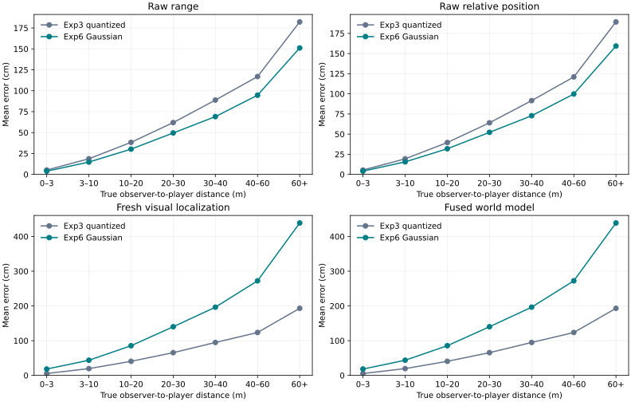
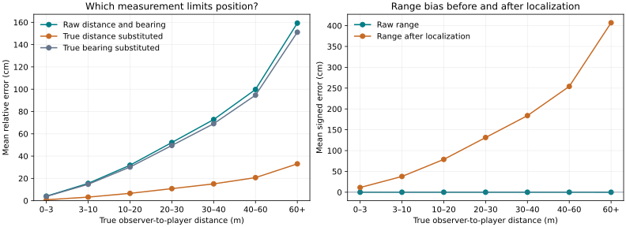

# Exp6 · Gaussian visual noise versus Exp3 quantization

**Gaussian player range MAE was 59.6 cm, compared with
75.5 cm under quantization. Player WM position error was
170.6 cm versus 80.0 cm.**
Each experiment used 200 games with the stock agents and 360° vision.

[Exp3 report](../../exp3/reports/report.html) · [Exp6 metrics and scores](metrics.json) · [Run settings](../README.md) · [Step 1 range correction](range-replay/report.html)

## 1. Collection checks

All **4,400** Exp6 observer logs finalized. Both sides requested Gaussian and
used reference fullstate for labels. The runs share synchronized 360° vision,
persistent uniform numbers, standard motion-field fading and no player
messages. Exp6 disabled both exact-vision switches and used the standard
Gaussian rates for movable objects and landmarks. Random command-order
settings by observer were {'false': 4400}.

| Check | Exp3 quantized | Exp6 Gaussian |
| --- | ---: | ---: |
| PlayOn decisions | 21,539,323 | 20,881,423 |
| 360° view | 100.00% | 100.00% |
| High-quality view | 100.00% | 100.00% |
| Exactly one same-cycle see | 100.00% | 100.00% |
| Visual update used | 100.00% | 100.00% |
| Valid reference fullstate | 100.00% | 100.00% |
| Identified on-field player rows | 100.00% | 100.00% |
| Teammate payloads | 0 | 0 |
| Skipped-decision placeholders, all modes | 0 | 0 |

Exp6 had **438,509,883** eligible on-field player rows with reference geometry.
Among available WM player positions, **100.00%** had position
count 0. **99.90%** of known ranges fell outside
the 0.1 m grid. The batch retained the parsed fields in CSV. Gaussian
acknowledgment packets were verified in the collection pilot.

All **200** match scores agree with AutoTest2D. Goals were
**666–642**, with **91/23/86**
left wins/draws/losses. Both teams used the same setup.

## 2. Player error from the sensor to the world model

| Mean error | Exp3 quantized | Exp6 Gaussian |
| --- | ---: | ---: |
| Raw range MAE (cm) | 75.52 | 59.64 |
| Raw bearing MAE (°) | 0.250 | 0.250 |
| Raw relative position (cm) | 78.07 | 62.86 |
| Relative position with true range (cm) | 13.24 | 13.05 |
| Relative position with true bearing (cm) | 75.52 | 59.64 |
| Localized relative position (cm) | 80.01 | 170.40 |
| Visual global position (cm), paired | 80.04 | 170.60 |
| WM global position (cm), paired | 80.04 | 170.60 |
| WM global position (cm), all available | 80.04 | 170.60 |

Each cell below shows **Exp3 / Exp6**. Raw relative position compares the
observed polar vector with the true vector in the observer's own frame.
Visual and WM global errors include observer pose error. The visual and WM
paired columns require both estimates for the same observer, target and
cycle within each experiment.

| True distance (m) | Raw range (cm) | Raw relative (cm) | Visual global (cm) | WM global (cm) |
| --- | ---: | ---: | ---: | ---: |
| 0–3 | 5.21 / 3.84 | 5.38 / 4.05 | 5.53 / 18.28 | 5.53 / 18.28 |
| 3–10 | 18.72 / 14.76 | 19.33 / 15.55 | 19.56 / 43.69 | 19.56 / 43.69 |
| 10–20 | 38.32 / 30.20 | 39.54 / 31.83 | 40.59 / 85.47 | 40.59 / 85.47 |
| 20–30 | 61.93 / 49.54 | 64.03 / 52.21 | 65.49 / 140.08 | 65.49 / 140.08 |
| 30–40 | 88.86 / 69.07 | 91.57 / 72.80 | 94.84 / 196.46 | 94.84 / 196.46 |
| 40–60 | 116.91 / 94.66 | 120.96 / 99.77 | 123.52 / 272.32 | 123.52 / 272.32 |
| 60+ | 182.25 / 151.13 | 189.23 / 159.28 | 193.13 / 438.86 | 193.13 / 438.86 |

| Target | Exp3 raw relative (cm) | Exp6 raw relative (cm) | Exp3 WM position (cm) | Exp6 WM position (cm) |
| --- | ---: | ---: | ---: | ---: |
| Teammate | 76.22 | 61.00 | 78.13 | 165.30 |
| Opponent | 79.76 | 64.56 | 81.78 | 175.43 |

Gaussian range MAE was **0.79×** the
quantized baseline. Weighting Gaussian by Exp3's distance-bin counts gives
**60.4 cm**. These are independent games, so differences in
geometry can remain within each bin.

The analysis includes PlayOn only and gives every eligible sample equal
weight. Raw and visual player errors require an unambiguous uniform-number
association. All-available WM errors include any valid matched track. Exp3
uses its archived aggregates, which limit comparisons to shared measurements.

## 3. The Gaussian distance model and the localization step

Substituting true distance on the same Exp6 rows reduces mean raw relative
position error from **62.9 to
13.0 cm**. Substituting true bearing leaves
**59.6 cm**. Each substitution changes one
measurement and uses truth for diagnosis.

Mean signed raw Gaussian range error is **-0.01 cm**. The norm of
librcsc's localized relative vector minus true distance averages
**+158.81 cm**. On rows with both ranges, MAE is
**59.6 cm before localization** and
**167.8 cm after localization**. Comparing
the two ranges removes observer position and heading from this check.
In librcsc, the lookup selects the first quantization-table bin whose
reported value is at least the observed distance minus 0.001 m. Continuous
Gaussian values between bins therefore often move to the next bin. This
explains the upward bias. Replaying the stock table reproduced
**409,563 / 409,563** logged localized
ranges within 0.15 mm on four observer streams from the first and last games.
[Lookup replay evidence](lookup-replay.json)

| True distance (m) | Raw signed error (cm) | Localized signed error (cm) | Raw MAE (cm), paired | Localized MAE (cm), paired |
| --- | ---: | ---: | ---: | ---: |
| 0–3 | 0.00 | 11.26 | 3.84 | 11.76 |
| 3–10 | 0.00 | 37.84 | 14.76 | 40.03 |
| 10–20 | 0.00 | 78.82 | 30.20 | 83.35 |
| 20–30 | 0.00 | 131.36 | 49.54 | 138.26 |
| 30–40 | -0.01 | 183.91 | 69.07 | 194.71 |
| 40–60 | -0.01 | 254.09 | 94.66 | 268.10 |
| 60+ | -0.05 | 406.97 | 151.13 | 431.00 |

Exp6 player WM position error exceeded 50 cm in
**78.61%** and 1 m in **57.69%**
of available tracks.

The server sets σ = d × distance rate + f × focus rate, where d is the
true observer-to-object distance and f is the true focus-to-object distance.
It clamps the noisy distance at zero. The table checks
**z = (observed distance − true distance) / σ**. Nonzero observer focus distance
appears in **0.00%** of labeled
PlayOn decisions.

| Object | Samples | Mean z | Std dev z | abs(z) > 1 | abs(z) > 2 | abs(z) > 3 |
| --- | ---: | ---: | ---: | ---: | ---: | ---: |
| Players | 438,509,883 | -0.0001 | 1.0000 | 31.73% | 4.55% | 0.27% |
| Ball | 20,881,423 | 0.0002 | 1.0002 | 31.73% | 4.55% | 0.27% |
| Flags and goals | 1,148,475,988 | -0.0001 | 1.0000 | 31.73% | 4.55% | 0.27% |
| Standard normal | — | 0 | 1 | 31.73% | 4.55% | 0.27% |

## 4. Velocity and body fields

Both raw motion fields were available for **55.68%**
of Exp3 targets and **56.94%** of Exp6 targets.

| Mean error | Exp3 quantized | Exp6 Gaussian |
| --- | ---: | ---: |
| Raw distance-change MAE (m/cycle) | 0.0730 | 0.0033 |
| Raw bearing-change MAE (°/cycle) | 0.0241 | 0.0243 |
| Raw body MAE (°) | 0.2500 | 0.2500 |
| Raw head MAE (°) | 0.2500 | 0.2500 |
| Visual velocity error (m/cycle) | 0.0745 | 0.0119 |
| WM velocity error (m/cycle) | 0.0942 | 0.0558 |

| True distance (m) | Exp3 motion fields | Exp6 motion fields | Exp3 body angle | Exp6 body angle |
| --- | ---: | ---: | ---: | ---: |
| 0–3 | 100.00% | 100.00% | 100.00% | 100.00% |
| 3–10 | 100.00% | 100.00% | 100.00% | 100.00% |
| 10–20 | 99.95% | 99.97% | 99.95% | 99.97% |
| 20–30 | 75.63% | 75.80% | 75.63% | 75.80% |
| 30–40 | 26.80% | 26.93% | 26.80% | 26.93% |
| 40–60 | 0.00% | 0.12% | 0.00% | 0.12% |
| 60+ | 0.00% | 0.00% | 0.00% | 0.00% |

Coverage uses all eligible on-field targets. Error means use observations
with the relevant field or a valid estimate. The server scales raw radial
change with the same noisy distance ratio before rounding. Bearing, body
and head use the same angular encoding as the quantized mode.

## 5. Ball, landmarks and self in Exp6

| Exp6 object and measure | Mean error | Samples |
| --- | ---: | ---: |
| Ball raw distance | 54.83 cm | 20,881,423 |
| Ball raw relative position | 57.79 cm | 20,881,423 |
| Ball visual global position | 158.15 cm | 20,881,423 |
| Ball WM position | 158.15 cm | 20,881,423 |
| Ball WM velocity | 0.1503 m/cycle | 16,578,601 |
| Landmark raw distance | 11.11 cm | 1,148,475,988 |
| Landmark raw bearing | 0.250° | 1,148,475,988 |
| Self fresh visual position fix | 12.81 cm | 20,881,423 |
| Self WM position | 12.96 cm | 20,881,423 |
| Self WM velocity | 0.0026 m/cycle | 20,881,423 |
| Self WM looking direction | 0.250° | 20,881,423 |

These measures give Exp6 reference points for later modeling. The archived
Exp3 player metrics cover the player comparisons above.

## Reproduce

Run from the denoise workspace. The first command streams the compressed
CSVs and retains per-game totals for resuming interrupted runs.

    exp=rcssserver-denoise/experiments/exp6
    mkdir -p "$exp/reports"
    python3 "$exp/reporting/analyze_logs.py" logs/exp6-logs logs/exp6-analysis/baseline-200 --autotest AutoTest2D/out/exp6logs --autotest AutoTest2D/out/exp6logs2
    .venv-exp5-s1/bin/python "$exp/reporting/verify_lookup.py" logs/exp6-logs librcsc-denoise/rcsc/player/object_table.cpp "$exp/reports/lookup-replay.json"
    .venv-exp5-s1/bin/python "$exp/reporting/render_report.py" rcssserver-denoise/experiments/exp3/reports/exp3-metrics.json logs/exp6-analysis/baseline-200/metrics.json "$exp/reports"

