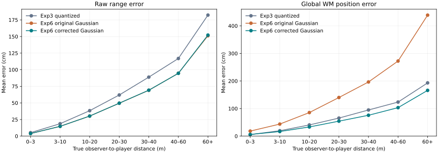

# Exp6 · corrected Gaussian in live games

**100 completed matches** were found in AutoTest2D exp6logs3 and the
matching player-log directory exp6-logs3. The original Exp6 Gaussian run and
the archived Exp3 quantized run each contain 200 games.

Correcting the range lookup lowered player WM error from
**170.60 to 66.38 cm** across the two
Gaussian live batches. The corrected mean is consistent with the separate
fixed-pose replay estimate of 67.48 cm. These are independently played matches.

All 2,200 observer logs finalized with corrected Gaussian
localization enabled. Every one of the 10,769,374 PlayOn decisions logged a
single 360° visual update and same-cycle reference truth, with no skipped
decision placeholders or teammate payloads. All 226,156,854 identified
player positions were fresh. All 100 match scores agree with AutoTest2D
(421–410 goals, 42/16/42 left wins/draws/losses).
Both sides used the same configuration.

| Mean error | Exp3 quantized | Exp6 original Gaussian | Exp6 corrected Gaussian |
| --- | ---: | ---: | ---: |
| Raw player range MAE (cm) | 75.52 | 59.64 | 60.63 |
| Raw relative player position (cm) | 78.07 | 62.86 | 63.90 |
| Signed player range error after localization (cm) | — | 158.812 | -0.004 |
| Player WM position (cm) | 80.04 | 170.60 | 66.38 |
| Player WM velocity (m/cycle) | 0.0942 | 0.0558 | 0.0797 |
| Ball WM position (cm) | — | 158.15 | 61.26 |
| Ball WM velocity (m/cycle) | — | 0.1503 | 0.1165 |
| Self WM position (cm) | — | 12.96 | 3.74 |
| Self WM looking direction (°) | — | 0.250 | 0.250 |

## Player WM error by true distance, cm

| True distance (m) | Exp3 quantized | Exp6 original Gaussian | Exp6 corrected Gaussian |
| --- | ---: | ---: | ---: |
| 0–3 | 5.53 | 18.28 | 6.04 |
| 3–10 | 19.56 | 43.69 | 16.70 |
| 10–20 | 40.59 | 85.47 | 33.28 |
| 20–30 | 65.49 | 140.08 | 54.30 |
| 30–40 | 94.84 | 196.46 | 75.63 |
| 40–60 | 123.52 | 272.32 | 103.30 |
| 60+ | 193.13 | 438.86 | 166.00 |

All means use equal weight per eligible observer/object/cycle in PlayOn.
The raw range comparison uses identified seen players. The WM means use
available valid estimates with reference truth. The Exp3 archive supports
comparisons for players. A dash marks an unavailable archival measure.

[Baseline and quantization comparison](../report.html) ·
[Fixed-pose replay](../range-replay/report.html) · [Metrics and match scores](metrics.json) ·
[Temporal denoising study](../temporal/report.html)

    exp=rcssserver-denoise/experiments/exp6
    python3 "$exp/reporting/analyze_logs.py" logs/exp6-logs3 logs/exp6-analysis/fixed-exp6logs3 --require-corrected --autotest AutoTest2D/out/exp6logs3
