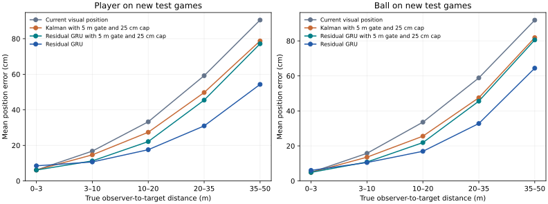

# Exp6 · Learn a correction from Gaussian observation history

The dataset now combines 100 previously logged corrected-Gaussian games and
200 new games. The new set supplied all training and validation rows, plus
a separate 20-game test. We also evaluated on the frozen 40-game benchmark
from the earlier physical-filter experiment.

| Cohort | Games | Player windows | Ball windows |
| --- | ---: | ---: | ---: |
| Training | 160 | 2,723,629 | 518,618 |
| Validation | 20 | 832,600 | 198,157 |
| New test | 20 | 815,393 | 194,173 |
| Earlier benchmark | 40 | 1,647,767 | 392,248 |

## Model and inputs

We trained separate 40-unit PyTorch GRUs for players and the
ball on Quadro P2200. Every example has up to
8 consecutive PlayOn observations ending at the current
cycle. A missing cycle or an interruption resets history. Before the first
eight observations the window is padded and carries a validity flag.

The visible inputs describe changes in visual position, the measured range
and estimated noise, the current and past viewing rays, measured velocity
when available, teammate flag, and the Kalman position correction. Vectors are
expressed along and across the current viewing direction. The GRU learns
how much of the Kalman correction to trust and adds a residual in both axes.
Fullstate provides the training target and the evaluation distance slices.

Each epoch randomly samples windows within each selected observer stream.
Observer numbers rotate across games. Validation chose one checkpoint per target by guarded
mean error plus 0.20 times uncapped mean error. The training loss emphasizes
close and medium distances and includes both guarded and uncapped position
error. The checkpoint can correct a position only. The ground truth of the
target velocity or body is outside this experiment.

| Target | Parameters | Selected epoch | Windows per epoch | Validation capped error (cm) | Validation uncapped error (cm) |
| --- | ---: | ---: | ---: | ---: | ---: |
| Player | 8,483 | 7 | 220,000 | 43.30 | 30.74 |
| Ball | 8,483 | 8 | 120,000 | 40.87 | 31.43 |

The score tables use the same sampled endpoints for all estimates. Test
endpoints use fixed cycle/identity strides, so physical-reference numbers
can differ from the earlier full-rate report. Each sample has equal weight.
The physical comparisons use the validated position-only Kalman for players
and the velocity-informed Kalman for the ball. Guarded variants keep visual
position below **5 m measured range** and cap other corrections at **25 cm**.
The cap bounds the added position error relative to the same visual estimate.

## New 20-game test

### Player

713,341 paired samples below 50 m.

| Method | Mean cm | Gain cm | Worsened >25 cm | Worsened >50 cm | Max added cm |
| --- | ---: | ---: | ---: | ---: | ---: |
| Current visual position | 55.61 | 0.00 | 0.00% | 0.00% | 0.00 |
| Kalman | 40.01 | 15.60 | 6.04% | 1.37% | 189.95 |
| Kalman with 5 m gate and 25 cm cap | 47.28 | 8.33 | 0.00% | 0.00% | 25.00 |
| Residual GRU | 31.00 | 24.61 | 4.71% | 1.25% | 216.56 |
| Residual GRU with 5 m gate and 25 cm cap | 43.48 | 12.13 | 0.00% | 0.00% | 25.00 |

Difference in mean between guarded GRU and guarded Kalman, with a whole-game
95% bootstrap interval **[-3.91, -3.68] cm**. Negative favors the GRU.

Under 3 m, the mean was 6.15 cm for the current
visual position, 8.51 cm for the uncapped GRU and
6.15 cm with the gate and cap.

### Ball

172,080 paired samples below 50 m.

| Method | Mean cm | Gain cm | Worsened >25 cm | Worsened >50 cm | Max added cm |
| --- | ---: | ---: | ---: | ---: | ---: |
| Current visual position | 51.87 | 0.00 | 0.00% | 0.00% | 0.00 |
| Kalman | 38.52 | 13.35 | 10.33% | 3.74% | 273.52 |
| Kalman with 5 m gate and 25 cm cap | 43.22 | 8.66 | 0.00% | 0.00% | 25.00 |
| Residual GRU | 31.54 | 20.33 | 6.06% | 2.30% | 255.80 |
| Residual GRU with 5 m gate and 25 cm cap | 40.95 | 10.92 | 0.00% | 0.00% | 25.00 |

Difference in mean between guarded GRU and guarded Kalman, with a whole-game
95% bootstrap interval **[-2.37, -2.16] cm**. Negative favors the GRU.

Under 3 m, the mean was 4.90 cm for the current
visual position, 6.05 cm for the uncapped GRU and
4.90 cm with the gate and cap.
## Earlier 40-game benchmark

### Player

1,443,959 paired samples below 50 m.

| Method | Mean cm | Gain cm | Worsened >25 cm | Worsened >50 cm | Max added cm |
| --- | ---: | ---: | ---: | ---: | ---: |
| Current visual position | 55.65 | 0.00 | 0.00% | 0.00% | 0.00 |
| Kalman | 39.95 | 15.70 | 5.95% | 1.36% | 211.46 |
| Kalman with 5 m gate and 25 cm cap | 47.25 | 8.40 | 0.00% | 0.00% | 25.00 |
| Residual GRU | 30.87 | 24.78 | 4.61% | 1.20% | 224.81 |
| Residual GRU with 5 m gate and 25 cm cap | 43.44 | 12.21 | 0.00% | 0.00% | 25.00 |

Difference in mean between guarded GRU and guarded Kalman, with a whole-game
95% bootstrap interval **[-3.89, -3.73] cm**. Negative favors the GRU.

Under 3 m, the mean was 6.02 cm for the current
visual position, 8.16 cm for the uncapped GRU and
6.02 cm with the gate and cap.

### Ball

350,307 paired samples below 50 m.

| Method | Mean cm | Gain cm | Worsened >25 cm | Worsened >50 cm | Max added cm |
| --- | ---: | ---: | ---: | ---: | ---: |
| Current visual position | 51.98 | 0.00 | 0.00% | 0.00% | 0.00 |
| Kalman | 38.62 | 13.36 | 10.43% | 3.88% | 1,375.76 |
| Kalman with 5 m gate and 25 cm cap | 43.32 | 8.66 | 0.00% | 0.00% | 25.00 |
| Residual GRU | 31.57 | 20.42 | 6.11% | 2.40% | 223.18 |
| Residual GRU with 5 m gate and 25 cm cap | 41.03 | 10.95 | 0.00% | 0.00% | 25.00 |

Difference in mean between guarded GRU and guarded Kalman, with a whole-game
95% bootstrap interval **[-2.37, -2.21] cm**. Negative favors the GRU.

Under 3 m, the mean was 4.92 cm for the current
visual position, 6.16 cm for the uncapped GRU and
4.92 cm with the gate and cap.

The evaluation measures position quality on recorded PlayOn observations.
Match outcomes require a separate test on live trajectories.

[Full metrics, validation curves and game split](metrics.json) ·
[Physical temporal comparison](../temporal/report.html) ·
[Corrected Gaussian live audit](../fixed-live/report.html)

    exp=rcssserver-denoise/experiments/exp6
    data=logs/exp6-analysis/learning-300/data
    run=logs/exp6-analysis/learning-300/gru40
    .venv-exp5-s1/bin/python "$exp/training/build_data.py" logs/exp6-logs3 "$exp/reports/fixed-live/metrics.json" "$exp/reports/temporal/confirmation-metrics.json" AutoTest2D/out/exp6logs3 "$data"
    .venv-exp5-s1/bin/python "$exp/training/train.py" "$data" "$run"
    .venv-exp5-s1/bin/python "$exp/training/render_learning.py" "$run/metrics.json" "$exp/reports/learning"
