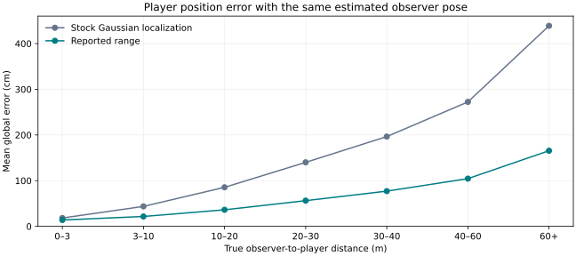

# Exp6 step 1 · Use reported Gaussian ranges in librcsc

With observer position and angle held fixed, player position error fell from
**170.60 to 67.48 cm** across the 200 Exp6 games.
Ball position error fell from **158.15 to 62.47 cm**.
The rebuilt librcsc applies the Gaussian range path after the server
acknowledges the mode. The live checks verified the reported-range path for
Gaussian and the original lookup for quantized observations.

[Original Exp6 baseline](../report.html) · [Replay metrics](replay-metrics.json) · [Pilot verification](pilot-audit.json)

## Paired replay on existing games

For each valid fresh localized observation, we kept the direction and origin
used by librcsc. The new position is the old global position plus
(reported range − localized range) times the unit localized relative vector.
Fullstate provides the reference for both error measurements. PlayOn rows
require both position estimates and the same-cycle truth, with a known
identity for players. Each sample has equal weight.

| Target | Paired rows | Stock cm | Raw range cm | Mean reduction | Improved >1 cm | Worsened >25 cm |
| --- | ---: | ---: | ---: | ---: | ---: | ---: |
| Players | 438,509,883 | 170.60 | 67.48 | 60.45% | 79.28% | 10.64% |
| Teammates | 208,814,230 | 165.30 | 65.51 | 60.37% | 79.45% | 10.55% |
| Opponents | 229,695,653 | 175.43 | 69.27 | 60.51% | 79.13% | 10.73% |
| Ball | 20,881,423 | 158.15 | 62.47 | 60.50% | 79.09% | 9.62% |

An improvement or regression means the change in the individual sample's
error against truth. Some Gaussian draws are closer to truth after the old
lookup, which can partially offset an underestimated range. The replay tests
the global visual fix along the recorded trajectories. The live changes can
also affect landmark localization, player/ball velocities and later actions.

| Player distance (m) | Stock cm | Raw range cm | Worsened >25 cm |
| --- | ---: | ---: | ---: |
| 0–3 | 18.28 | 13.97 | 0.03% |
| 3–10 | 43.69 | 21.61 | 2.49% |
| 10–20 | 85.47 | 36.23 | 7.08% |
| 20–30 | 140.08 | 56.26 | 11.13% |
| 30–40 | 196.46 | 77.08 | 12.41% |
| 40–60 | 272.32 | 104.45 | 14.85% |
| 60+ | 438.86 | 165.53 | 16.98% |

## What changed in librcsc

- Acknowledged Gaussian observations use reported distance for landmarks,
  players and the ball. The existing estimators get a working radial interval
  of ±2 estimated sigma, derived from the observer's player-type noise rates
  and measured range and focus geometry.
- Ball radial velocity uncertainty uses the Gaussian 0.01 m/cycle rounding
  step. At a reported range of zero it leaves direct velocity unavailable.
- Server exact-observation flags take precedence. The logged
  **gaussian_range_localization** field identifies the active range path.

## Short live controls

One stock and one updated match per sensor mode used the Exp6 360° preset,
the same simulator and player-type seeds and 22 finalized observers each.
Trajectories and the number of PlayOn rows vary by match.

| Short match | PlayOn observer cycles | Player WM cm | Ball WM cm | Self WM cm |
| --- | ---: | ---: | ---: | ---: |
| stock-gaussian | 7,394 | 162.09 | 132.69 | 12.86 |
| new-gaussian | 7,084 | 64.68 | 61.70 | 3.66 |
| stock-quantized | 6,842 | 73.57 | 61.62 | 1.53 |
| new-quantized | 7,700 | 76.22 | 63.93 | 1.55 |

| Short match | Player ranges checked | Ball ranges checked | Localized radial source |
| --- | ---: | ---: | ---: |
| stock-gaussian | 155,274 | 7,394 | quantization table |
| new-gaussian | 148,764 | 7,084 | reported distance |
| stock-quantized | 143,682 | 6,842 | quantization table |
| new-quantized | 161,700 | 7,700 | quantization table |

Every checked radius matched its expected source within 0.15 mm, including
allowance for CSV rounding near a table boundary. Updated Gaussian player
distance intervals also matched the expected two-sigma width in this
zero-focus run. These short matches test routing and estimate quality.
The paired replay is the population comparison.

## Reproduce

    exp=rcssserver-denoise/experiments/exp6
    python3 "$exp/reporting/analyze_logs.py" logs/exp6-logs logs/exp6-analysis/raw-range-replay-200 --autotest AutoTest2D/out/exp6logs --autotest AutoTest2D/out/exp6logs2
    .venv-exp5-s1/bin/python "$exp/reporting/analyze_range_pilot.py" /home/nader/workspace/denoise/logs/exp6-analysis/final-range-pilot-yB9YQa logs/exp6-analysis/raw-range-replay-200/scan_logs librcsc-denoise/rcsc/player/object_table.cpp /home/nader/workspace/denoise/logs/exp6-analysis/final-range-pilot-yB9YQa/routing-audit.json
    .venv-exp5-s1/bin/python "$exp/reporting/render_range_study.py" logs/exp6-analysis/raw-range-replay-200/metrics.json /home/nader/workspace/denoise/logs/exp6-analysis/final-range-pilot-yB9YQa/routing-audit.json "$exp/reports/range-replay"
