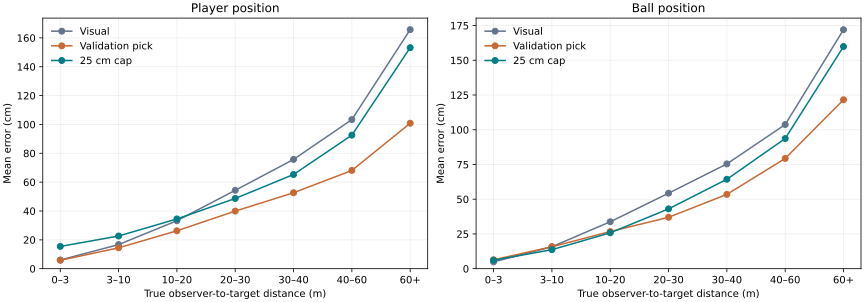

# Exp6 · first Gaussian temporal denoising study

The corrected visual position is the baseline. We compared two-frame
averages with Kalman filters that combine previous motion and the current
measured position. Player and ball candidates are selected separately.
The evaluation covers 40 held-out games after choosing settings on
20 other games. Each game contributes four observers with rotating
uniform numbers, balanced between the two sides.

| Target | Selection | Validation choice | Visual cm | Test cm | 95% change interval, cm | Worsened >25 cm |
| --- | ---: | ---: | ---: | ---: | ---: | ---: |
| Player | Lowest mean | Kalman, position only | 55.90 | 40.17 | [-16.34, -15.12] | 6.06% |
| Player | 25 cm cap | Kalman + velocity, quick + 25 cm cap | 55.90 | 51.44 | [-4.83, -4.12] | 0.00% |
| Ball | Lowest mean | Kalman + velocity, medium | 52.26 | 38.89 | [-13.70, -13.04] | 10.40% |
| Ball | 25 cm cap | Kalman + velocity, medium + 25 cm cap | 52.26 | 43.67 | [-8.74, -8.43] | 0.00% |

A negative change in the interval means lower position error than the visual
baseline. The intervals resample whole matches. A 25 cm cap limits how far
the output can move from the visual position in each cycle. By the triangle
inequality, it also limits added position error to 25 cm.

## Close targets below 3 m

| Target below 3 m | Visual cm | Best mean filter cm | 25 cm cap cm | Best mean worsened >25 cm |
| --- | ---: | ---: | ---: | ---: |
| Player | 6.05 | 5.83 | 15.45 | 0.00% |
| Ball | 4.89 | 6.42 | 6.09 | 1.75% |

Distance slices use reference truth for analysis. These slices show how the
overall improvements vary near the observer. The filters use measured range
and pose during inference.

## All candidates under 50 m on the held-out games

### Players

| Method | Mean cm | Gain cm | Worsened >25 cm | Worsened >50 cm | Max added cm |
| --- | ---: | ---: | ---: | ---: | ---: |
| Current visual position | 55.90 | 0.00 | 0.00% | 0.00% | 0.00 |
| Kalman, position only | 40.17 | 15.73 | 6.06% | 1.39% | 991.37 |
| Average two positions | 47.73 | 8.17 | 16.70% | 3.98% | 786.65 |
| Average with one-cycle velocity prediction | 51.36 | 4.54 | 5.23% | 0.84% | 784.53 |
| Kalman + velocity, quick + 25 cm cap | 51.44 | 4.46 | 0.00% | 0.00% | 25.00 |
| Kalman + velocity, medium + 25 cm cap | 51.78 | 4.12 | 0.00% | 0.00% | 25.00 |
| Kalman + velocity, smooth + 25 cm cap | 52.34 | 3.56 | 0.00% | 0.00% | 25.00 |
| Kalman + velocity, quick + 50 cm cap | 53.07 | 2.83 | 24.14% | 0.00% | 50.00 |
| Kalman + velocity, medium + 50 cm cap | 54.01 | 1.89 | 27.16% | 0.00% | 50.00 |
| Kalman + velocity, smooth + 50 cm cap | 55.34 | 0.57 | 29.77% | 0.00% | 50.00 |
| Kalman + velocity, quick | 70.12 | -14.22 | 35.50% | 22.64% | 1,418.32 |
| Kalman + velocity, medium | 77.46 | -21.56 | 41.88% | 28.59% | 1,420.69 |
| Kalman + velocity, smooth | 87.91 | -32.00 | 47.99% | 34.74% | 1,428.47 |

### Ball

| Method | Mean cm | Gain cm | Worsened >25 cm | Worsened >50 cm | Max added cm |
| --- | ---: | ---: | ---: | ---: | ---: |
| Current visual position | 52.26 | 0.00 | 0.00% | 0.00% | 0.00 |
| Kalman + velocity, medium | 38.89 | 13.37 | 10.40% | 3.83% | 1,620.17 |
| Kalman + velocity, medium + 50 cm cap | 40.31 | 11.95 | 8.24% | 0.00% | 50.00 |
| Kalman + velocity, smooth + 50 cm cap | 40.58 | 11.68 | 10.21% | 0.00% | 50.00 |
| Kalman + velocity, quick | 41.15 | 11.11 | 8.74% | 2.60% | 1,618.41 |
| Kalman + velocity, smooth | 41.34 | 10.92 | 14.22% | 6.95% | 1,629.94 |
| Kalman + velocity, quick + 50 cm cap | 41.80 | 10.46 | 7.30% | 0.00% | 50.00 |
| Kalman, position only | 43.67 | 8.59 | 7.03% | 1.94% | 966.16 |
| Kalman + velocity, medium + 25 cm cap | 43.67 | 8.59 | 0.00% | 0.00% | 25.00 |
| Kalman + velocity, smooth + 25 cm cap | 43.74 | 8.52 | 0.00% | 0.00% | 25.00 |
| Kalman + velocity, quick + 25 cm cap | 44.47 | 7.79 | 0.00% | 0.00% | 25.00 |
| Average with one-cycle velocity prediction | 50.02 | 2.23 | 8.65% | 4.15% | 905.92 |
| Average two positions | 68.87 | -16.61 | 41.98% | 22.82% | 905.43 |

“Worsened” measures the increase in Euclidean error compared with the current
visual position for the same sample.

## How the filters work

- **Two-frame averages.** Average the previous and current observed positions.
  The velocity version advances the previous position by the previous direct
  visual velocity first, and uses the current fix when that velocity is missing.
- **Kalman filters.** Predict the current position with a constant-velocity
  state. Trust the current measurement less along the viewing ray when
  estimated Gaussian range noise is large. Including direct visual velocity
  offers another update when both motion fields are present. Filters differ
  in how quickly they allow motion to change. The ball uses larger process
  and velocity uncertainty.
- **Caps.** Limit the output correction to 25 or 50 cm. Prediction history
  is updated from the underlying filter state. The cap applies to evaluation
  output each cycle.

Inputs use current and past observations only. Track history restarts when
a consecutive PlayOn observation is missing. Truth is read for scoring after
calculating the outputs, and supplies the distance slices. Validation
chooses the lowest mean error under 50 m, once among all candidates and once
among the 25 cm capped candidates. Test trajectories are the recorded games
played with corrected Gaussian localization.

The reported variance settings are working estimates for filtering. They
approximate correlated position and velocity measurements. This study
measures current position error on recorded trajectories. Live decisions
and gameplay need a separate evaluation.

## Confirmation on 40 additional games

The first test found that filtering could worsen close positions, especially
for the ball. The follow-up uses the current visual position when the measured
range is below 5 m and caps position corrections at 25 cm elsewhere.
Validation chose the position-only filter for players and the medium
position-and-velocity filter for the ball. The same validation games were
used for selection. The 40 confirmation games differ from the first 40 test games.

| Target under 50 m | Visual cm | Filtered cm | 95% change interval, cm | Worsened >25 cm |
| --- | ---: | ---: | ---: | ---: |
| Player | 55.58 | 47.20 | [-8.56, -8.20] | 0.00% |
| Ball | 51.98 | 43.31 | [-8.80, -8.53] | 0.00% |

| Target under 3 m | Rows | Visual cm | Filtered cm | Max added cm |
| --- | ---: | ---: | ---: | ---: |
| Player | 102,455 | 6.04 | 6.04 | 0.00 |
| Ball | 31,689 | 4.93 | 4.93 | 0.00 |

Distance slices use true distance for evaluation. The gate uses measured
Gaussian range. The 25 cm cap bounds added position error relative to the
visual estimate for each sample.

[Confirmation split and metrics](confirmation-metrics.json)

[Live corrected Gaussian audit](../fixed-live/report.html) ·
[Split and numerical results](metrics.json)

    exp=rcssserver-denoise/experiments/exp6
    .venv-exp5-s1/bin/python "$exp/reporting/analyze_temporal.py" logs/exp6-logs3 logs/exp6-analysis/temporal-exp6logs3
